# Art Explainer Video · 画作赏析视频


把一幅画做成有依据、保留原作质感的赏析视频。由《溪山行旅图》《早春图》《雪中猎人》《汉宫春晓图》《富春山居图》《千里江山图》以及「名画开小差」片头与《美国哥特式》的实际制作过程整理，供支持 `SKILL.md` 的智能体使用。

支持单画赏析、同一或不同艺术家的多作品解读，以及画中人物虚构对白小剧场；剪辑可选沉静赏析或快节奏、丰富贴纸与音效的趣味艺术史。覆盖原画研究、讲解脚本、按叙事需要交代原作尺幅、AI 动态试样、统一音色、BGM 与音效、字幕精剪、封面和发布文案。当前工具组合是 YouMind、Seed Audio、直接运行的 Remotion / FFmpeg 与剪映；可按任务替换或只执行其中一部分。**新制作不依赖 Open Montage**。

本仓库提供制作方法、计划检查和可选的本地渲染脚本；完整制作仍需要作品资料、素材、脚本与相应服务权限。本仓库不包含凭据、单集原画母版、完整单集视频或私人项目链接。附带示例静帧、原创合成人物尺幅素材，以及可直接使用的「名画开小差」片头MP4和音乐/音效分轨。

## 作品截图

下面是 Gallery Mate 小红书《读画》已发布成片的静帧，取自横版播放画面，不是本地未完成的剪辑。三则笔记：

- [山这么大，赶路的人在哪里？《溪山行旅图》](https://www.xiaohongshu.com/explore/6ae13ff5000000002a01cb13?xsec_token=ABV6f6fcg56H4-f2MrOyRFP0C97prYFSvVe7o7cjgHNCU=&xsec_source=pc_user)
- [郭熙的早春，原来藏在空白里](https://www.xiaohongshu.com/explore/6ae1f8a6000000002a01dd24?xsec_token=ABV6f6fcg56H4-f2MrOyRFP_pAh9MHbveqpeCp5SZzZ5o=&xsec_source=pc_user)
- [《雪中猎人》严冬里，生活仍在继续](https://www.xiaohongshu.com/explore/6ae2092700000000350213d0?xsec_token=ABCJDknoN25ga1eqgRpuxIjeTF8xYnAehz8QzMHyEyONg=&xsec_source=pc_user)

| 《溪山行旅图》 | 《早春图》 | 《雪中猎人》 |
| :---: | :---: | :---: |
| 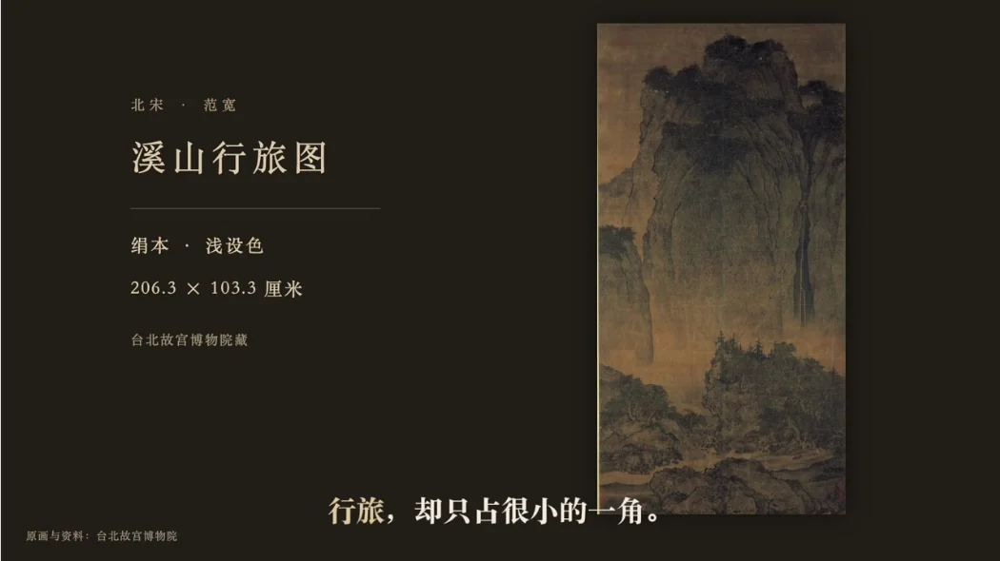 | 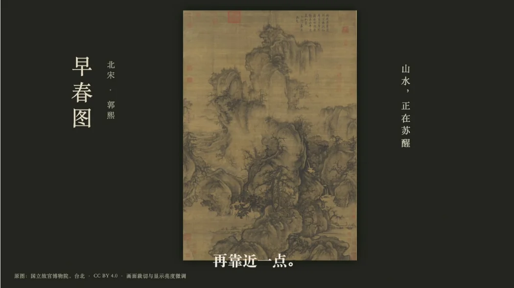 | 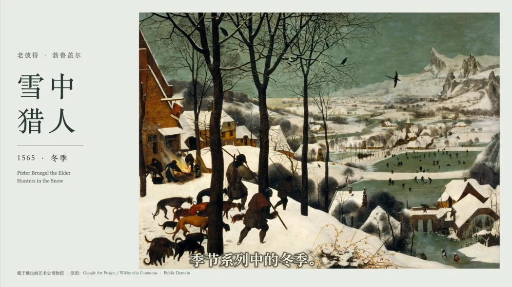 |
| 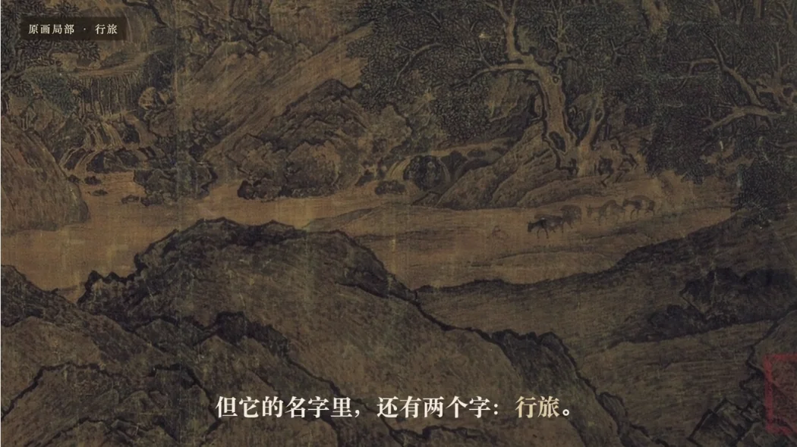 | 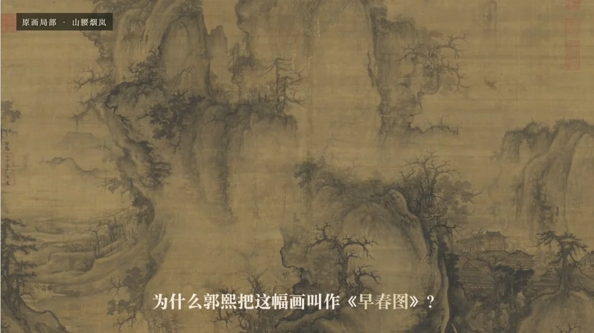 | 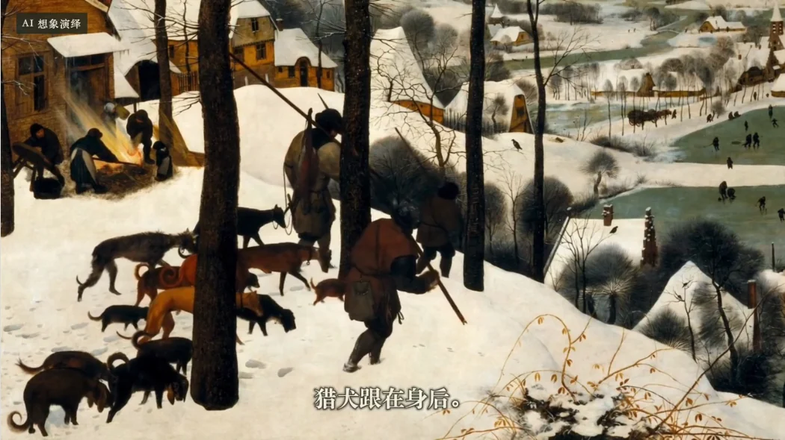 |

上一行是片头，下一行分别是原画行旅局部、原画山腰烟岚局部，以及《雪中猎人》猎人与猎犬的 **AI 想象演绎静帧**。生成静帧不作为原作细节证据。

## 安装与使用

例如，在 Codex 中安装：

```bash
gh repo clone xiaoiver/art-explainer-video ~/.codex/skills/art-explainer-video
```

目标目录应不存在；已有安装请在该目录查看更改后更新。其他支持 Agent Skills 的工具可将仓库放入其技能目录。入口是 [SKILL.md](SKILL.md)：它只恢复范围并选定一种风格，制作步骤在对应的 `styles/*/STYLE.md`。

需要本地画面渲染时，复制 [最小 Remotion 环境](assets/remotion-runtime/package.json) 到自己的项目并执行 `npm ci`，再用 [render_remotion.py](scripts/render_remotion.py) 或官方 CLI。运行环境只声明 Remotion CLI、Remotion、React、React DOM 四个直接依赖，并附依赖锁文件；不需要旧框架的仓库或指令。安装、代表帧检查、短样和整片命令见 [独立渲染](shared/remotion-rendering.md)。只做研究、脚本或复用现成片头时无需安装它。

示例请求：

> 使用 $art-explainer-video 制作《千里江山图》的 2 分钟赏析视频。先核实原画资料，以原作局部讲解为主，保留青绿山水质感，穿插少量 AI 动态。视频 16:9，封面 4:3。先提供脚本、一个动态镜头和一段音色试样。

也可以仅请求：“沿用已经确认的音色，继续配乐、字幕与剪映精剪，并更新制作记录。”

支持选择**横版、竖版或两个版本**。只说横版时建议1920 × 1080（16:9），竖版时建议1080 × 1920（9:16）；指定其他比例时以用户要求为准。视频和封面分别配置。

> 把已完成的《雪中猎人》再做一版9:16竖版。沿用配音、配乐和已选动态，重新安排原画局部、完整构图、字幕换行和安全区，保留横版文件。

横转竖需要重新取景与排版，不是整片居中裁切。方法见 [横竖版](shared/formats.md)。

> 制作一支长卷赏析：开头让高清原画满宽缓慢浏览，先选能看清细节的一段，随后短暂交代整卷尺幅。不要把整卷缩成细带配大标题，沿用已选声音和后续素材。

也可以制作人物小剧场：

> 使用 $art-explainer-video 做一集「名画开小差」。参考《美国哥特式》的展厅推进、人物对白和退回原画结构，为新画作写一个有原画事实依据的冷面笑话。沿用已确认片头，视频16:9、封面4:3。

多作品也可以围绕一个共同问题制作：

> 比较范宽《溪山行旅图》和郭熙《早春图》：同样画大山，视线怎样走进去？做一支趣味艺术史短片，节奏快些，多用贴纸、圈线和音效揭示差异；原画证据和作品身份保持清楚。先给比较问题、取材表和短样，再按已有授权继续。

方法见[多作品解读](shared/multi-artwork.md)与[趣味艺术史剪辑](styles/playful/STYLE.md)。后者借鉴vibe-motion的主动作、分层和刹车节奏，不自动安装合集或改变现有渲染路线；不将原画变形成特效来证明构图或笔法。

只给已完成正片加片头，不重新调用生成服务：

```bash
python3 scripts/prepend_intro.py --episode /path/to/episode.mp4 \
  --output /path/to/episode-with-intro.mp4 --subtitles /path/to/episode.srt
```

详见[片头复用](shared/series-intro.md)。脚本需要FFmpeg/ffprobe，会按叠化重叠量计算字幕顺延；不修改剪映工程，不向平台上传。

## 文件导航

三种风格分开写。跨风格工艺在 `shared/`，复盘在 `cases/<风格>/`，示例计划在 `examples/<风格>/`。多作品解读和系列片头可以与一种风格组合。

| 文件 | 用途 |
| --- | --- |
| [SKILL.md](SKILL.md) | 入口：恢复范围、选定一种风格 |
| [沉静赏析](styles/contemplative/STYLE.md) | 默认读画主线：资料、分镜、试样、声音与验收 |
| [趣味艺术史](styles/playful/STYLE.md) | 快推、贴纸、圈线、漫画气泡、声音击点、阅读停留与帧级编排 |
| [名画小剧场](styles/theatre/STYLE.md) | 原创对白、真实展厅照片与虚构画心、同源首尾帧、Seedance原生音画与回归原画 |
| [多作品解读](shared/multi-artwork.md) | 同艺术家系列、跨作者同题比较、作品关联叙事与独立来源/尺幅 |
| [统一片头](shared/series-intro.md) | 「名画开小差」4秒/1.5秒MP4、声音分轨、思源宋体字标、可选源码与字幕顺延 |
| [片头拼接脚本](scripts/prepend_intro.py) | 保持正片画幅和帧率，音画叠化，统一移动SRT，拒绝覆盖输入 |
| [画面与脚本](shared/art-direction.md) | 证据、资料优先级、原画定位、尺幅、表面细节、叙事节奏、同作者对照与生成提示词 |
| [长卷开头](shared/long-scroll-opening.md) | 满宽慢移、观看顺序、高清分段拼接、接尺幅与转场检查 |
| [长卷组件](assets/long-scroll/LongScrollPan.tsx) | 可选Remotion等比平移组件，配套几何函数与参数示例 |
| [尺幅参照人物](shared/scale-reference.md) | 自然站姿透明 PNG、可见身高边界、等比缩放脚本与横竖版合成方法 |
| [顶部章节导航](shared/chapter-navigation.md) | 竖版固定章节栏、当前段高亮、React组件与《万壑松风图》实际时码示例 |
| [题跋与印章](shared/inscriptions-and-seals.md) | 从题名、后人观看与收藏流传中选取有依据的故事 |
| [工具接入](shared/tooling.md) | YouMind、Seed Audio、独立 Remotion / FFmpeg 的接入与恢复 |
| [独立 Remotion 渲染](shared/remotion-rendering.md) | 最小运行环境、本地 CLI、代表帧与短样、计划预检及渲染报告 |
| [直接渲染脚本](scripts/render_remotion.py) | 调用已安装 CLI，成功探测后落盘，保留运行报告；不自动安装或生成素材 |
| [声音制作](shared/audio.md) | 音色试样、分轨、循环与时间校准 |
| [音效选材与来源台账](shared/sound-sourcing.md) | 外录/自录与生成声音的选择、逐镜头声音表、源片段、许可署名和跨集复用 |
| [声音计划检查](scripts/validate_sound.py) | 可选本地音频探测、SHA-256、片段能量分析、CSV声音表与署名导出 |
| [字体与文字层级](shared/typography.md) | 南西油墨宋封面与篇名、宋体字幕及淡金重点词、文楷诗句短释文；真实排字与原生回退检查 |
| [封面的画字融合](shared/cover-design.md) | 古画传统字体、纸绢留白、参考图生图与独立排字的选择，以及两次封面修订 |
| [剪辑与交付](shared/editing-delivery.md) | 剪映、真实导出、验收与制作记录 |
| [横竖版与重新构图](shared/formats.md) | 方向选择、原画局部、宽幅全景、字幕安全区与素材复用 |
| [计划文件格式](shared/project-format.md) | 可选 JSON 格式与检查命令 |


## 案例与示例

以下是已完成制作的复盘，以及可校验的分镜计划，不是默认工作流地图。部分早期案例保留当时实际使用 Open Montage 的记录；新项目按当前独立渲染路线执行，无需安装该历史框架。

| 文件 | 用途 |
| --- | --- |
| [捣练图实测编排](examples/contemplative/daolian-produced-plan.json) | 125.458秒、22镜、4:3封面；复用此片验证独立 Remotion 渲染，不含媒体 |
| [渔村小雪图制作案例](cases/contemplative/wangshen-yucunxiaoxue-produced-case.md) | 120.667秒、22镜、59条字幕：三段视角、题名流传、南西油墨宋封面与剪映字体兼容性取舍 |
| [渔村小雪图实测编排](examples/contemplative/wangshen-yucunxiaoxue-produced-plan.json) | 16:9视频、4:3封面、两段AI笔墨延展的实际时码；不含媒体或私人路径 |
| [双画趣味比较草案](examples/playful/multi-artwork-playful-plan.json) | 范宽/郭熙两幅山水围绕视线入口比较；含贴纸/运镜/声音提示，90秒预估，无媒体或成片 |
| [瑞鹤图音效选材草案](examples/contemplative/ruihe-sound-draft.json) | 下一版真实风声/鹤鸣的待选时码示例，不含录音、不改写既有生成音轨来源 |
| [美国哥特式案例](cases/theatre/american-gothic-case.md) | 人物小剧场、剪映v4与带片头v5、原画回归、4:3封面和致敬文案 |
| [美国哥特式时间线](examples/theatre/american-gothic-theatre.json) | 已交付31.25秒的阶段与同源素材关系，不含整集媒体 |
| [溪山行旅图案例](cases/contemplative/xishan-case.md) | 已完成案例的选择、指标与限制 |
| [早春图案例](cases/contemplative/early-spring-case.md) | 题款题诗、开场声音修订与 146 秒成片复盘 |
| [早春图分镜计划](examples/contemplative/early-spring-plan.json) | 对应修订版的 25 个主画面镜头，不含媒体 |
| [雪中猎人案例](cases/contemplative/hunters-in-snow-case.md) | 西方绘画、授权配乐与独立竖版重构 |
| [雪中猎人竖版计划](examples/contemplative/hunters-in-snow-portrait-plan.json) | 9:16视频与独立4:3封面，23个主画面镜头，不含媒体 |
| [汉宫春晓图案例](cases/contemplative/hangong-chunxiao-case.md) | 满宽开场、原画拼接、题记、声音复用与v2实际验收范围 |
| [汉宫春晓图计划](examples/contemplative/hangong-chunxiao-plan.json) | 16:9、146秒、20镜头与独立3:4封面，不含媒体 |
| [汉宫开头参数](examples/contemplative/hangong-opening.json) | 7621 × 1846原画浏览段与1920 × 780视窗，只适用于本片 |
| [富春山居图案例](cases/contemplative/fuchun-shanju-case.md) | 已完成且用户确认发布；半印与断口、原图与气氛动态、读音和配乐v2修订 |
| [富春山居图计划](examples/contemplative/fuchun-shanju-plan.json) | 16:9、132秒、22镜头与独立4:3封面，不含媒体 |
| [千里江山图案例与原提案](cases/contemplative/qianli-jiangshan-case.md) | 已交付136秒成片与4:3融合封面；保留原提案的资料依据和使用条件，非最终时间线 |
| [千里江山图原提案计划](examples/contemplative/qianli-jiangshan-plan.json) | 制作前150秒、12镜头与3:4封面的预估示例，不含媒体；与最终成片不同 |
| [荷石水鸟图制作与修订案例](cases/contemplative/bada-heshi-shuiniu-case.md) | 横版60秒、13镜、鸟与鱼对照、六款分工字体、放缓语速与展讯核实；保留单画配音前提案 |
| [荷石水鸟图计划](examples/contemplative/bada-heshi-shuiniu-plan.json) | 16:9、约40秒、8镜头与独立3:4封面的预估示例，不含媒体 |
| [水鸟与鱼图实测编排](examples/contemplative/bada-bird-fish-produced-plan.json) | v3的60秒、13镜编排：原画眼神对照、逐画身份标注；无媒体与私有路径 |
| [揭钵图 × 鬼趣图制作案例](cases/contemplative/jiebo-guiqu-case.md) | 130.333秒、24镜：原卷定位、同本核实、磁性男声；v4去通用提示，YouMind生成4:3融合封面；保留预估计划 |
| [揭钵图 × 鬼趣图计划](examples/contemplative/jiebo-guiqu-plan.json) | 16:9、约120秒、22镜预估与4:3封面，不含媒体 |
| [揭钵与鬼趣实测编排](examples/contemplative/jiebo-guiqu-produced-plan.json) | 130.333秒、3128帧、24镜、61条字幕的编排摘录；无媒体或私有路径 |

### 预制作：张波《从“画中书”到“画中人”》（读书图的读法）

这一组只做书页整理，尚未进入制作；口播、分镜与配音留待以后另做。[整理说明](cases/contemplative/zhangbo-huazhongshu/README.md)、[转录](cases/contemplative/zhangbo-huazhongshu/从画中书到画中人.md)、[画作清单](cases/contemplative/zhangbo-huazhongshu/画作清单.md)与[出处备忘](cases/contemplative/zhangbo-huazhongshu/SOURCES.md)在同一目录。正式刊名、年期与起止页仍未核实。仓库只收已压缩的书页裁切与馆藏公开预览（`images/crops/` 四张、`images/public/` 四张，最大约 473 KB）。13 张书页照片与高清馆藏母版未收入。图5、图6、图8及原刊图7整页，以及 p.53 正文，在文稿中仍标为缺失。公共下载不等于商业许可。

## 本地检查

计划检查脚本仅依赖 Python 3.9+ 标准库；只有 `--probe` 需要可执行的 `ffprobe`。

```bash
python3 scripts/validate_plan.py examples/contemplative/xishan-plan.json
python3 scripts/validate_plan.py examples/contemplative/early-spring-plan.json
python3 scripts/validate_plan.py examples/contemplative/hunters-in-snow-portrait-plan.json
python3 scripts/validate_plan.py examples/contemplative/hangong-chunxiao-plan.json
python3 scripts/validate_plan.py examples/contemplative/fuchun-shanju-plan.json
python3 scripts/validate_plan.py examples/contemplative/qianli-jiangshan-plan.json
python3 scripts/validate_plan.py examples/contemplative/bada-heshi-shuiniu-plan.json
python3 scripts/validate_plan.py examples/contemplative/jiebo-guiqu-plan.json
python3 scripts/validate_plan.py examples/contemplative/jiebo-guiqu-produced-plan.json
python3 scripts/validate_plan.py examples/contemplative/wangshen-yucunxiaoxue-produced-plan.json
python3 scripts/validate_plan.py examples/contemplative/daolian-produced-plan.json
python3 scripts/validate_plan.py examples/theatre/american-gothic-theatre.json
python3 scripts/validate_plan.py examples/playful/multi-artwork-playful-plan.json
python3 scripts/validate_sound.py examples/contemplative/ruihe-sound-draft.json
python3 -m unittest discover -s tests -v
```

声音流程支持真实录音、自录、已有系列素材与生成音频。新增选材参考文档与项目台账，借鉴[vibe-motion/sound](https://github.com/vibe-motion/sound)的选材方法，未复制其脚本或引入其代理修复与推广流程。声音检查脚本默认仅验证草案；完成选材后可用以下命令生成本地校验报告、声音表和署名，详见[格式与限制](shared/sound-sourcing.md#可选声音计划与检查脚本)：

```bash
python3 scripts/validate_sound.py /path/to/sound-plan.json \
  --ready --analyze --report /path/to/sound-report.json \
  --cue-sheet /path/to/cues.csv --credits /path/to/sound-credits.txt
```

`--ready`要求ffprobe，`--analyze`另需ffmpeg，均只读取本地媒体。校验不代表许可自动获准、人工试听或最终混音听感通过；未知来源在草案保留为警告，交付前检查会拒绝未选定或许可待核的被引用素材。脚本不联网搜索下载，不替代现有YouMind/Seed Audio生成或FFmpeg/剪映混音流程。

可选长卷组件依赖使用者现有的React / Remotion环境；几何测试另用Node.js 22.18+：

```bash
node --experimental-strip-types --test tests/test_long_scroll.mjs
```

《溪山行旅图》示例是简化重建计划，《早春图》和《汉宫春晓图》分别保留修订版的25镜、20镜时间线；《富春山居图》保留132秒、22镜的实际编排；《千里江山图》JSON保留制作前150秒、12镜原提案，最终成片另为136秒、18镜，见案例页。单画《荷石水鸟图》JSON保留制作前约40秒、8镜提案；双画JSON摘录成片v3的60秒、13镜实际编排，见案例页。《揭钵图》×《鬼趣图》分别保留120秒、22镜预估和130.333秒、24镜实测编排。均不含可下载的私人素材，也不是可以直接渲染的完整工程。使用自己的文件填充素材路径和交付路径后，可加 `--check-files --probe` 核对实际媒体。

制作环境的安装按需执行，不能因为调用此 skill 就默认安装整套工具。计划检查脚本已用本次实际成片与封面验证；尚未在全新机器上重跑完整制作。生成、试听、剪辑软件兼容性仍须在使用者环境中确认。

## 更多案例

### 《汉宫春晓图》

开头约15秒满宽缓慢浏览连续的一段原画，文字退为辅助；随后6秒交代完整尺幅，再进入局部讲解。仅浏览一段，不在短开场快速扫完整卷。方法见 [长卷开头](shared/long-scroll-opening.md)，实际制作见 [案例](cases/contemplative/hangong-chunxiao-case.md)。

| 第5秒：满宽浏览 | 第18秒：尺幅参照 |
| :---: | :---: |
| 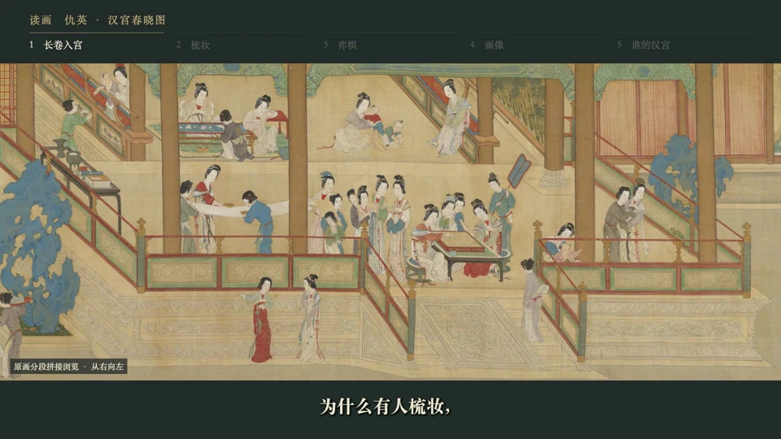 | 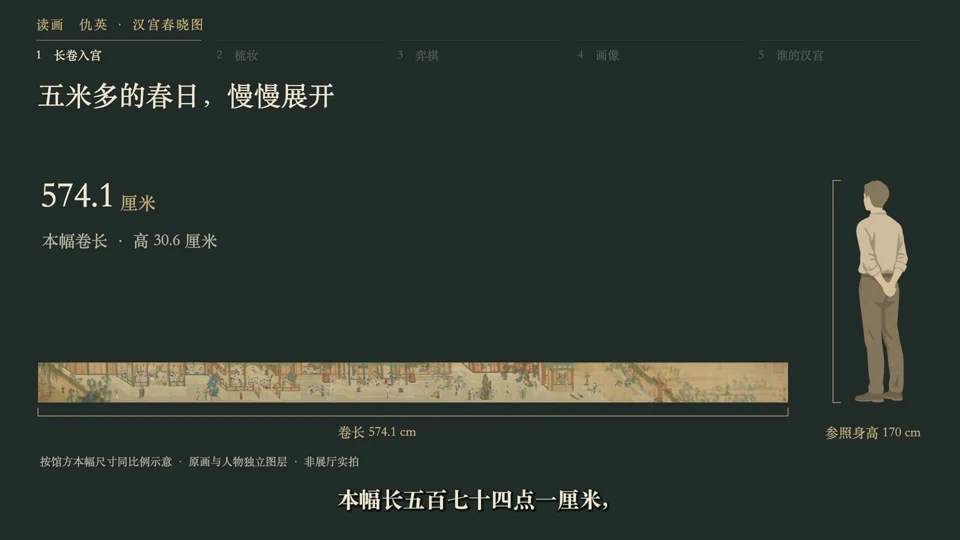 |

### 《富春山居图》

[案例复盘](cases/contemplative/fuchun-shanju-case.md)记录原画半印、长卷局部浏览、尺幅、水墨气氛动态，以及“藏”读cáng和配乐换轨的修订。

最新独立封面见下方画字融合示例；下图来自实际成片：

| 第17秒：原画与成人尺幅 | 第41秒：原图半印对照 |
| :---: | :---: |
| 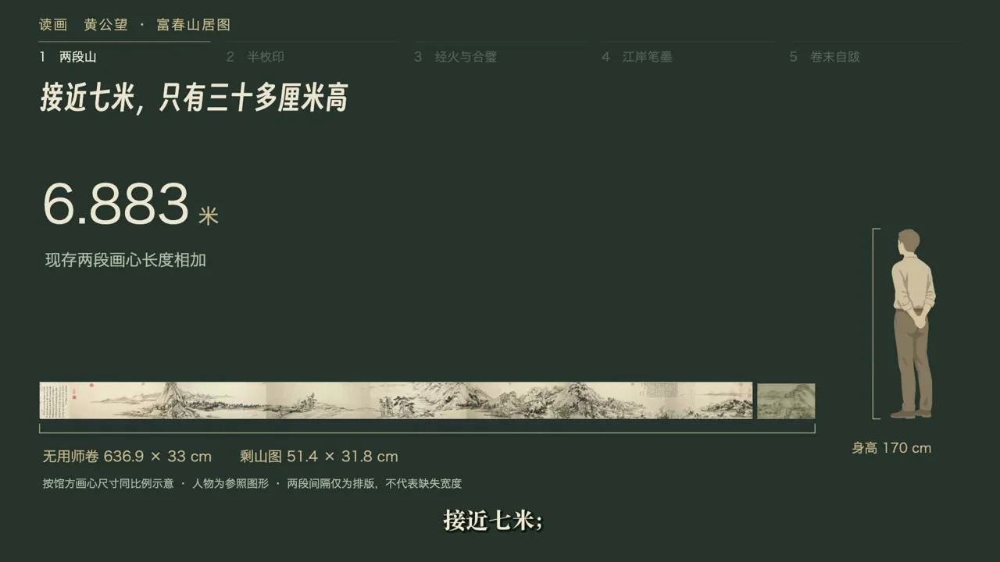 | 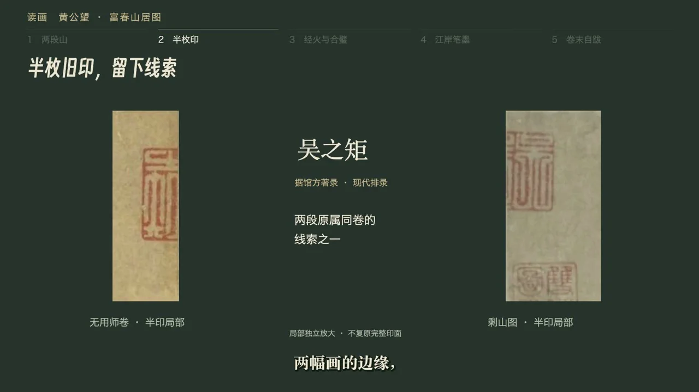 |

尺幅和半印静帧含原画裁切及图文叠加，来源与使用说明见[案例](cases/contemplative/fuchun-shanju-case.md#半印自跋与原图边界)。两段水墨气氛动态另有片内标识，不用于证明印文或笔法。

### 封面画字融合示例

本系列古画封面优先传统字体，让文字自然落在纸绢留白，与山水共同构图。当前固定分工为：南西油墨宋用于封面与视频篇名，宋体用于连续字幕及同字体淡金重点词，文楷按需用于景名、诗句与短释文。需要准确字体文件时，用参考生成的无字底图加真实字体排字。方法见[字体分工](shared/typography.md)与[封面的画字融合](shared/cover-design.md)。

| 《富春山居图》横版封面v3 | 《千里江山图》封面v2 |
| :---: | :---: |
| 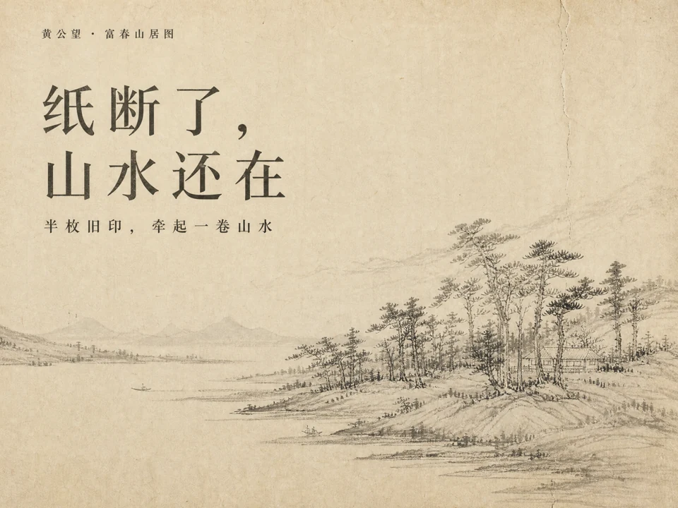 |  |

这是2026-10-31后续重做的本地封面预览，尚未替换已发布笔记的封面。两张均通过YouMind的GPT Image 2参考生成，原图各为2304×1728，已核对文字、缩略图和Board可见性。封面属于创意重构，非原画复制品；随图文字不是准确字体文件或独立文字层。实际做法见[富春山居图案例](cases/contemplative/fuchun-shanju-case.md#后续封面v3传统字体融入纸本水墨)与[千里江山图案例](cases/contemplative/qianli-jiangshan-case.md#当前交付与融合封面2026-10-31)。

### 《渔村小雪图》：真实字体排字

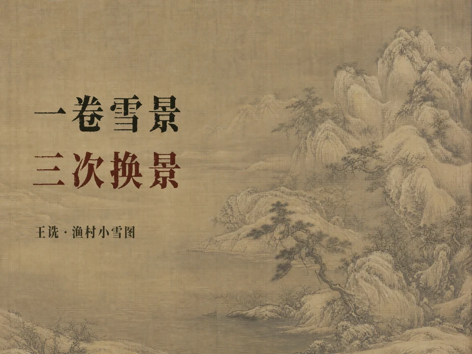

2026-11-04本地完成120.667秒横版视频，用户已确认满意。封面先用YouMind参考生成无字底图，再使用真实南西油墨宋字体排字；上图是创意重构的缩略图，字体文件由使用者自备。本库不分发该字体或单集原画母版。[制作案例](cases/contemplative/wangshen-yucunxiaoxue-produced-case.md)记录了22镜、59条宋体字幕、题名流传与剪映字体回退的取舍；[实测编排](examples/contemplative/wangshen-yucunxiaoxue-produced-plan.json)不含媒体或私人路径。

## 「名画开小差」与《美国哥特式》

这是用户已确认的本地交付案例，尚无已发布笔记的核实链接。[制作复盘](cases/theatre/american-gothic-case.md)保留了参考节目结构与本片原创对白的区别、展厅照片署名、Seed Audio参考声音与Seedance原生音轨的关系，以及v4原生导出、v5外部拼接的边界。

| 固定片头：思源宋体版 | 本集：原画风格的4:3封面 |
| :---: | :---: |
| 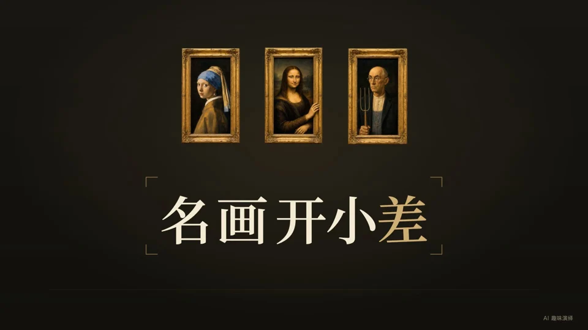 |  |

| 开头：展厅画框内已是演员复景 | 退出：完整画框露出后回到原画 |
| :---: | :---: |
| 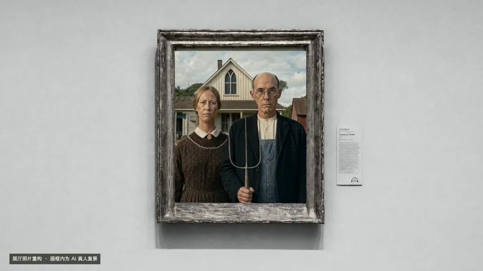 | 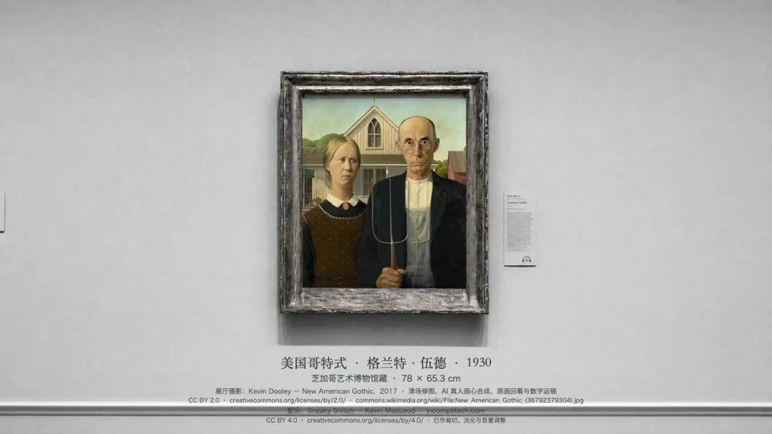 |

展厅静帧改编自Kevin Dooley的2017年照片，CC BY 2.0；来源、处理方式及完整署名见[案例来源](cases/theatre/american-gothic-case.md#素材与声音)。封面和片头人物是生成的艺术化重构，不作为原画细节证据。

可直接复用的[4秒片头](assets/series-intro/intro-4s-v2.mp4)、[1.5秒短版](assets/series-intro/intro-short-v2.mp4)、[音乐](assets/series-intro/music.wav)与[音效](assets/series-intro/sfx.wav)随库提供。MP4已经混音；不要再叠分轨。只需加片头时无需重生成；修改角色或画幅则使用自己的透明母版与字体，详见[片头源码所需素材](shared/series-intro.md#素材生成与可编辑源)。

### 莫迪里阿尼：多作品趣味艺术史

2026-11-03本地完成71.125秒9:16短片，三件原作围绕姿态、线条与人物关系接力，采用已获认可的展示字/手写吐槽/宋体字幕分工。包含真实语速测量、多音字改写及可编辑剪映字幕的[制作复盘](cases/playful/modigliani-case.md)；未把本地影片或他人参考视频打包进技能。
