# Art Explainer Video · 画作赏析视频


把一幅画做成有依据、保留原作质感的赏析视频。由《溪山行旅图》《早春图》《雪中猎人》《汉宫春晓图》与《富春山居图》的实际制作过程整理，供支持 `SKILL.md` 的智能体使用。

覆盖原画研究、讲解脚本、让手机观众看见原作尺幅的一拍、AI 动态试样、统一音色、BGM 与音效、字幕精剪、封面和发布文案。已实践的工具组合是 YouMind、Seed Audio、Open Montage、Remotion / FFmpeg 与剪映；可按任务替换或只执行其中一部分。

本仓库提供制作方法与计划检查脚本，**不是一键渲染器**。媒体服务与剪辑软件需要使用者自己的访问权限；本仓库不包含凭据、原画母版、完整视频或音频素材、私人项目链接。附带下述成片示例静帧，以及可复用的原创合成人物尺幅素材。

## 作品截图

下面是 Gallery Mate 小红书《读画》已发布成片的静帧，取自横版播放画面，不是本地未完成的剪辑。三则笔记：

- [山这么大，赶路的人在哪里？《溪山行旅图》](https://www.xiaohongshu.com/explore/6ae13ff5000000002a01cb13?xsec_token=ABV6f6fcg56H4-f2MrOyRFP0C97prYFSvVe7o7cjgHNCU=&xsec_source=pc_user)
- [郭熙的早春，原来藏在空白里](https://www.xiaohongshu.com/explore/6ae1f8a6000000002a01dd24?xsec_token=ABV6f6fcg56H4-f2MrOyRFP_pAh9MHbveqpeCp5SZzZ5o=&xsec_source=pc_user)
- [《雪中猎人》严冬里，生活仍在继续](https://www.xiaohongshu.com/explore/6ae2092700000000350213d0?xsec_token=ABCJDknoN25ga1eqgRpuxIjeTF8xYnAehz8QzMHyEyONg=&xsec_source=pc_user)

| 《溪山行旅图》 | 《早春图》 | 《雪中猎人》 |
| :---: | :---: | :---: |
| 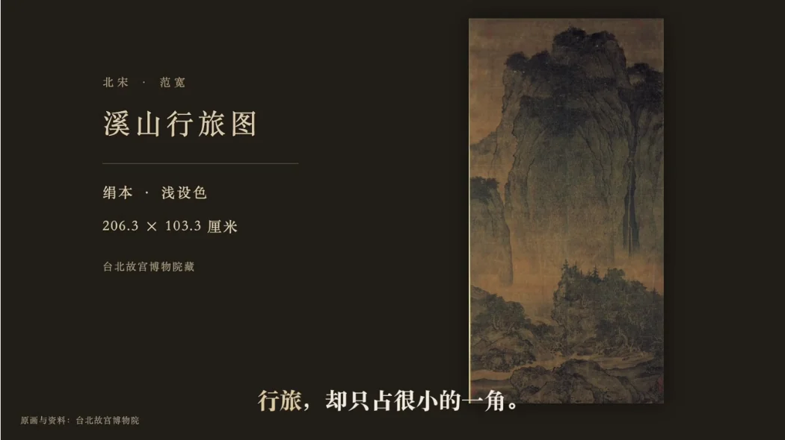 | 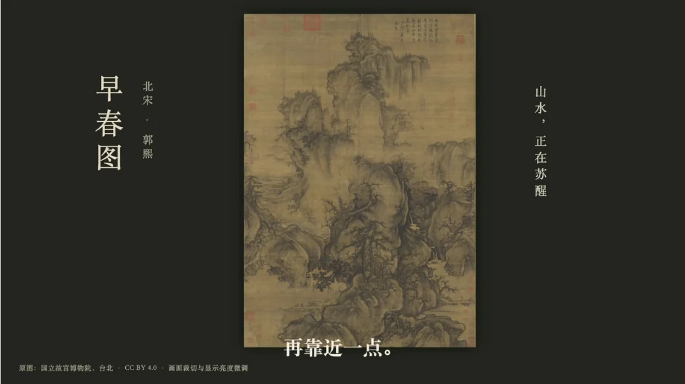 | 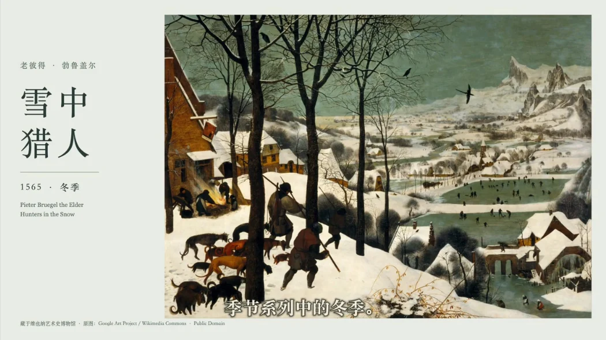 |
| 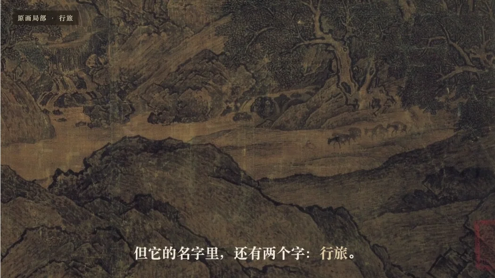 | 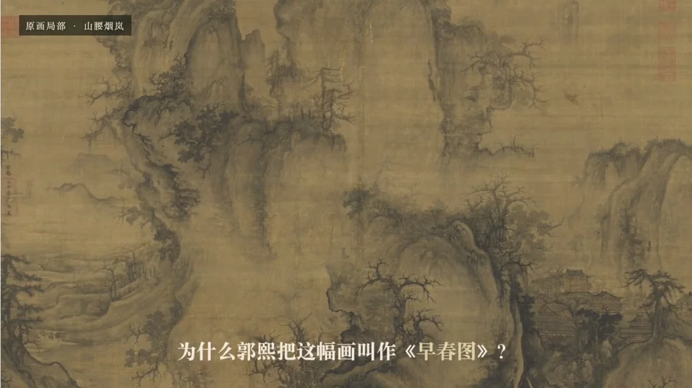 | 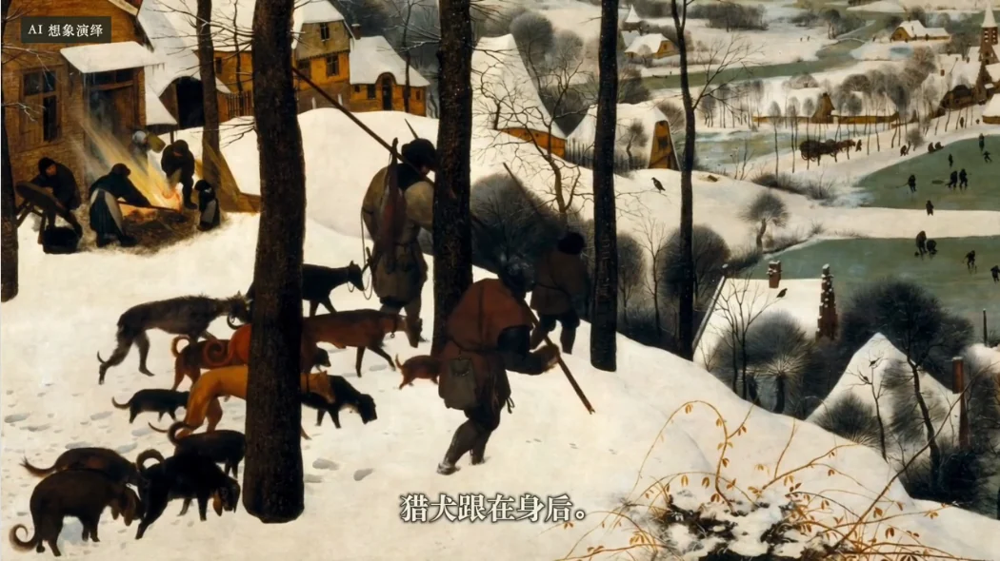 |

上一行是片头，下一行分别是原画行旅局部、原画山腰烟岚局部，以及《雪中猎人》猎人与猎犬的 **AI 想象演绎静帧**。生成静帧不作为原作细节证据。

### 长卷开头示例：《汉宫春晓图》

以下来自2026-10-30的本地v2成片，尚未上传或发布社交平台。开头约15秒满宽缓慢浏览连续的一段原画，文字退为辅助；随后6秒交代完整尺幅，再进入局部讲解。仅浏览一段，不在短开场快速扫完整卷。方法见 [长卷开头](references/long-scroll-opening.md)，实际制作见 [案例](references/hangong-chunxiao-case.md)。

| 第5秒：满宽浏览 | 第18秒：尺幅参照 |
| :---: | :---: |
| 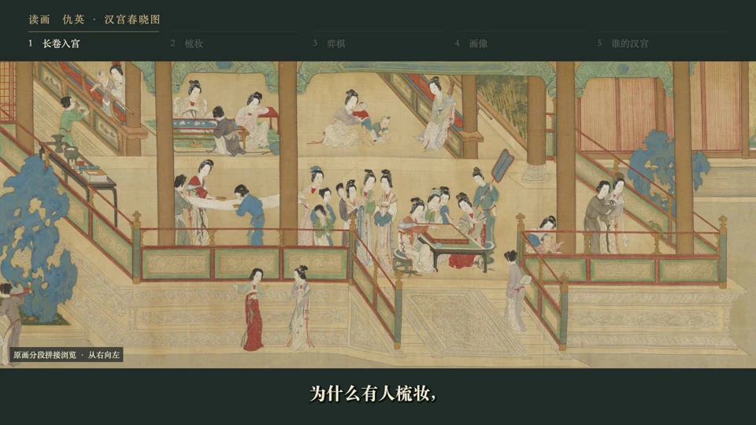 | 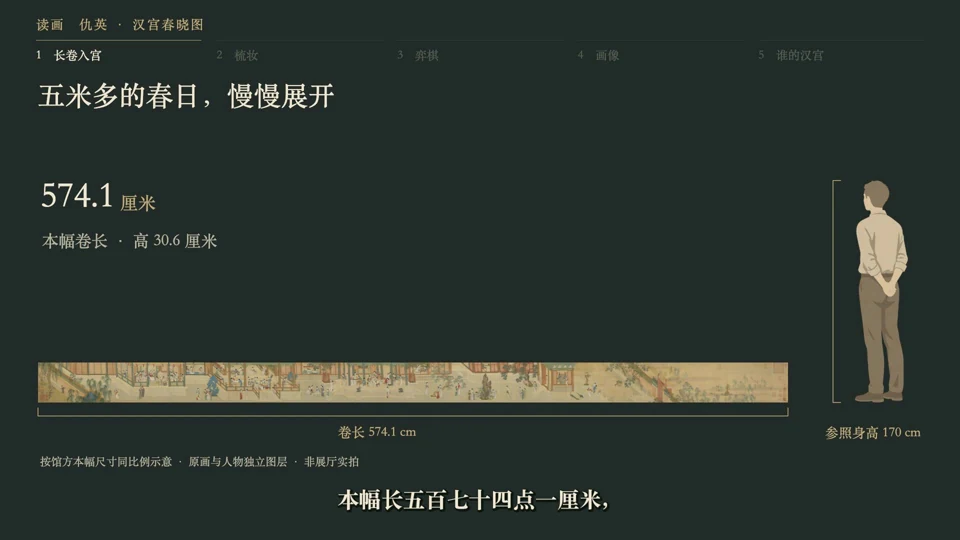 |

### 新增已发布案例：《富春山居图》

用户于2026-10-31确认本集已发布，公开笔记链接尚未登记。最后交付v2为**16:9、132秒、22镜头**，封面独立**4:3**；[案例复盘](references/fuchun-shanju-case.md)记录原画半印、长卷局部浏览、尺幅、水墨气氛动态，以及“藏”读cáng和配乐换轨的修订。

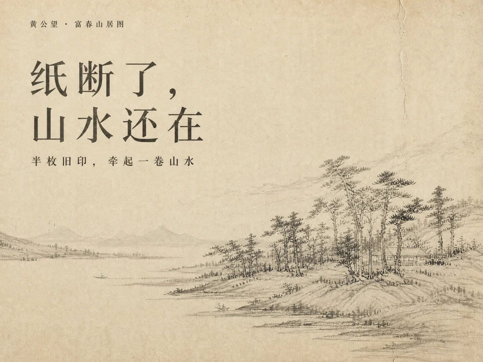

上图是独立封面，标有“封面意境演绎”，不是原画证据。下图来自实际成片：

| 第17秒：原画与成人尺幅 | 第41秒：原图半印对照 |
| :---: | :---: |
| 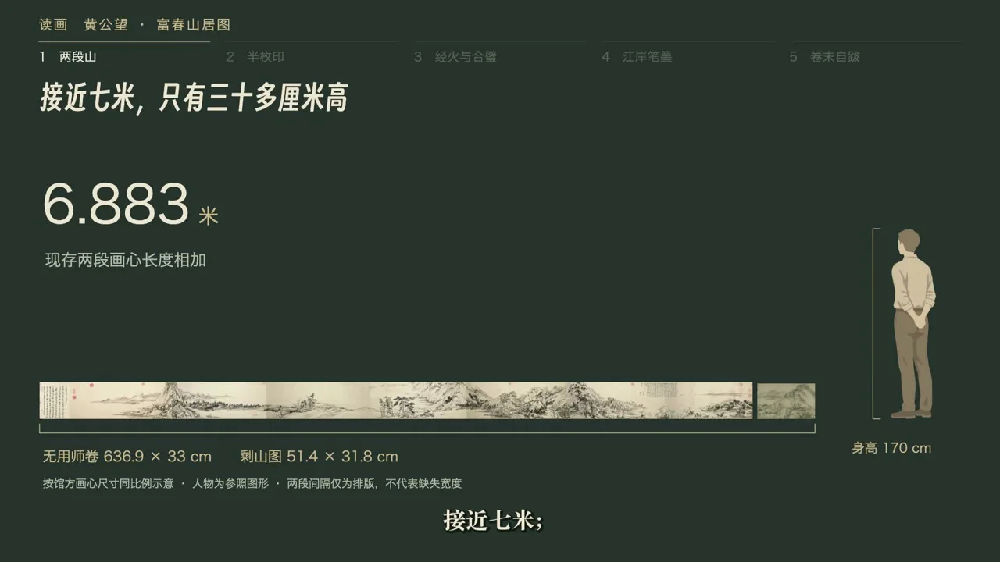 | 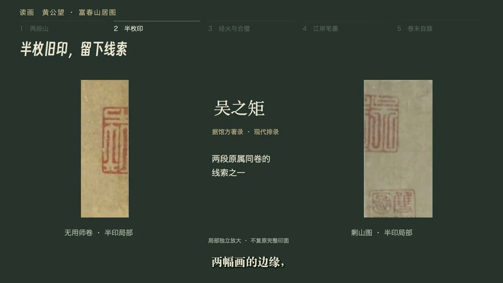 |

尺幅和半印静帧含原画裁切及图文叠加，来源与使用说明见[案例](references/fuchun-shanju-case.md#半印自跋与原图边界)。两段水墨气氛动态另有片内标识，不用于证明印文或笔法。

## 安装与使用

例如，在 Codex 中安装：

```bash
gh repo clone xiaoiver/art-explainer-video ~/.codex/skills/art-explainer-video
```

目标目录应不存在；已有安装请在该目录查看更改后更新。其他支持 Agent Skills 的工具可将仓库放入其技能目录。入口是 [SKILL.md](SKILL.md)。

示例请求：

> 使用 $art-explainer-video 制作《千里江山图》的 2 分钟赏析视频。先核实原画资料，以原作局部讲解为主，保留青绿山水质感，穿插少量 AI 动态。视频 16:9，封面 4:3。先提供脚本、一个动态镜头和一段音色试样。

也可以仅请求：“沿用已经确认的音色，继续配乐、字幕与剪映精剪，并更新制作记录。”

支持选择**横版、竖版或两个版本**。只说横版时建议1920 × 1080（16:9），竖版时建议1080 × 1920（9:16）；指定其他比例时以用户要求为准。视频和封面分别配置。

> 把已完成的《雪中猎人》再做一版9:16竖版。沿用配音、配乐和已选动态，重新安排原画局部、完整构图、字幕换行和安全区，保留横版文件。

横转竖需要重新取景与排版，不是整片居中裁切。方法见 [横竖版](references/formats.md)。

> 制作一支长卷赏析：开头让高清原画满宽缓慢浏览，先选能看清细节的一段，随后短暂交代整卷尺幅。不要把整卷缩成细带配大标题，沿用已选声音和后续素材。

## 文件导航

| 文件 | 用途 |
| --- | --- |
| [SKILL.md](SKILL.md) | 智能体入口与工作流 |
| [画面与脚本](references/art-direction.md) | 证据、资料优先级、原画定位、尺幅、表面细节、叙事节奏、同作者对照与生成提示词 |
| [长卷开头](references/long-scroll-opening.md) | 满宽慢移、观看顺序、高清分段拼接、接尺幅与转场检查 |
| [长卷组件](assets/long-scroll/LongScrollPan.tsx) | 可选Remotion等比平移组件，配套几何函数与参数示例 |
| [尺幅参照人物](references/scale-reference.md) | 自然站姿透明 PNG、可见身高边界、等比缩放脚本与横竖版合成方法 |
| [顶部章节导航](references/chapter-navigation.md) | 竖版固定章节栏、当前段高亮、React组件与《万壑松风图》实际时码示例 |
| [题跋与印章](references/inscriptions-and-seals.md) | 从题名、后人观看与收藏流传中选取有依据的故事 |
| [工具接入](references/tooling.md) | YouMind、Seed Audio、Open Montage 的接入与恢复 |
| [声音制作](references/audio.md) | 音色试样、分轨、循环与时间校准 |
| [字体与文字层级](references/typography.md) | 宋体字幕、得意黑短标题、黑体导航标注，以及实际字体加载与封面独立排字 |
| [剪辑与交付](references/editing-delivery.md) | 剪映、真实导出、验收与制作记录 |
| [横竖版与重新构图](references/formats.md) | 方向选择、原画局部、宽幅全景、字幕安全区与素材复用 |
| [计划文件格式](references/project-format.md) | 可选 JSON 格式与检查命令 |


## 案例与示例

以下是已完成制作的复盘，以及可校验的分镜计划，不是默认工作流地图。

| 文件 | 用途 |
| --- | --- |
| [溪山行旅图案例](references/xishan-case.md) | 已完成案例的选择、指标与限制 |
| [早春图案例](references/early-spring-case.md) | 题款题诗、开场声音修订与 146 秒成片复盘 |
| [早春图分镜计划](examples/early-spring-plan.json) | 对应修订版的 25 个主画面镜头，不含媒体 |
| [雪中猎人案例](references/hunters-in-snow-case.md) | 西方绘画、授权配乐与独立竖版重构 |
| [雪中猎人竖版计划](examples/hunters-in-snow-portrait-plan.json) | 9:16视频与独立4:3封面，23个主画面镜头，不含媒体 |
| [汉宫春晓图案例](references/hangong-chunxiao-case.md) | 满宽开场、原画拼接、题记、声音复用与v2实际验收范围 |
| [汉宫春晓图计划](examples/hangong-chunxiao-plan.json) | 16:9、146秒、20镜头与独立3:4封面，不含媒体 |
| [汉宫开头参数](examples/hangong-opening.json) | 7621 × 1846原画浏览段与1920 × 780视窗，只适用于本片 |
| [富春山居图案例](references/fuchun-shanju-case.md) | 已完成且用户确认发布；半印与断口、原图与气氛动态、读音和配乐v2修订 |
| [富春山居图计划](examples/fuchun-shanju-plan.json) | 16:9、132秒、22镜头与独立4:3封面，不含媒体 |


## 本地检查

计划检查脚本仅依赖 Python 3.9+ 标准库；只有 `--probe` 需要可执行的 `ffprobe`。

```bash
python3 scripts/validate_plan.py examples/xishan-plan.json
python3 scripts/validate_plan.py examples/early-spring-plan.json
python3 scripts/validate_plan.py examples/hunters-in-snow-portrait-plan.json
python3 scripts/validate_plan.py examples/hangong-chunxiao-plan.json
python3 scripts/validate_plan.py examples/fuchun-shanju-plan.json
python3 -m unittest discover -s tests -v
```

可选长卷组件依赖使用者现有的React / Remotion环境；几何测试另用Node.js 22.18+：

```bash
node --experimental-strip-types --test tests/test_long_scroll.mjs
```

《溪山行旅图》示例是简化重建计划，《早春图》和《汉宫春晓图》分别保留修订版的25镜、20镜时间线；《富春山居图》保留132秒、22镜的实际编排。均不含可下载的私人素材，也不是可以直接渲染的完整工程。使用自己的文件填充素材路径和交付路径后，可加 `--check-files --probe` 核对实际媒体。

制作环境的安装按需执行，不能因为调用此 skill 就默认安装整套工具。计划检查脚本已用本次实际成片与封面验证；尚未在全新机器上重跑完整制作。生成、试听、剪辑软件兼容性仍须在使用者环境中确认。
