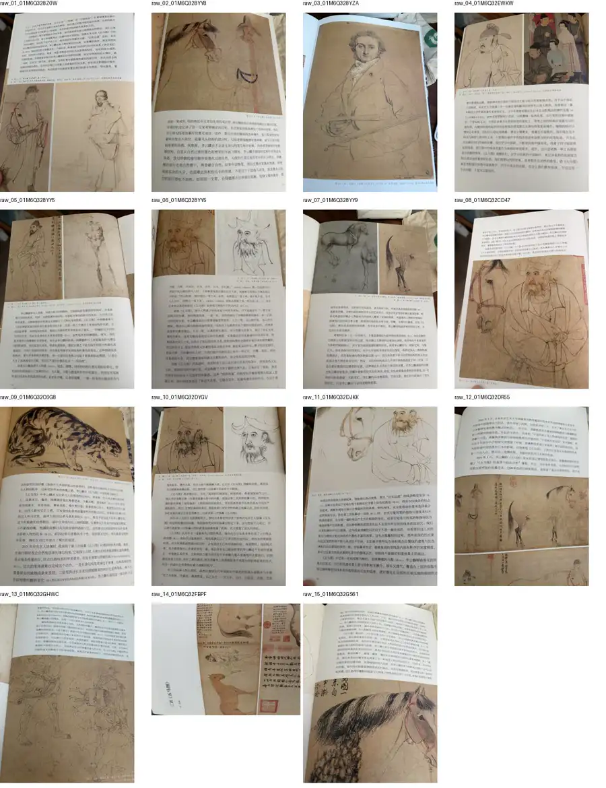

# 林皖「三访《五马图》」照片与页码

核对日期 2026-11-06。规则：照片里看得见印刷页码，标「确认」；看不见，标「推测」。缺页只记录推测，不补成事实。书页原片（HEIC / JPEG）不在本仓库。转录见 [linwan-wumatu-article-original.md](linwan-wumatu-article-original.md)。

下图是工作用接触印样的缩略图，900×1170，只帮助认哪一张对应哪一页。它不是高清母版，书页文字和临本也不能当作可再分发的图版。

| 序 | 页码 | 附件 HEIC | 工作区 JPEG | 内容要点 |
| --- | --- | --- | --- | --- |
| 1 | 推测（开篇跨页） | 01M6Q32FBPF61EFT3GPJYNB4CT.heic | pages/raw_14 | 标题「三访《五马图》」文 / 林皖；卷图 |
| 2 | 推测 | 01M6Q32DR55Z4KN0ZGTXFGFVGR.heic | pages/raw_12 | 2016 / 2019 交流开篇；卷图 |
| 3 | **确认 94** | 01M6Q32DYGV7HDMQAX2F5S52DB.heic | pages/raw_10 | 图2、图3 |
| 4 | **确认 95** | 01M6Q328YY5RXNKSRR8FWTPXYB.heic | pages/raw_06 | 图4、图5 |
| 5 | 推测 | 01M6Q328Z0WZ52FNGYXGR4J93H.heic | pages/raw_01 | 图6、图7 |
| 6 | 推测 | 01M6Q328YY9ZKX8VG79RG00DA6.heic | pages/raw_07 | 图8、图9 |
| 7 | **确认 98** | 01M6Q328YY5YY7K79PPKXJY4AT.heic | pages/raw_05 | 图10、图11 |
| 8 | 推测 | 01M6Q32GHWCMJ6AYX1X0SWEGGP.heic | pages/raw_13 | 图12 |
| 9 | 推测 | 01M6Q32CD47N6VFQH8M9F7PT2S.heic | pages/raw_08 | 图13 |
| 10 | 推测 | 01M6Q328YZA9T49Q2FSBJ1NVFK.heic | pages/raw_03 | 图14 |
| 11 | **确认 102** | 01M6Q32DJKKEPQE8GNX93ENACW.heic | pages/raw_11 | 图15 |
| 12 | 推测 | 01M6Q32GS61AMBPNNTGVKVBYC2.heic | pages/raw_15 | 图16；正文提图17–19 |
| 13 | **确认 105** | 01M6Q32C6G83CW6H12CPTHQ1AX.heic | pages/raw_09 | 图18 |
| 14 | **确认 107**（页角另见 172） | 01M6Q328YY842KDY4RQADV6HQ4.heic | pages/raw_02 | 图20 |
| 15 | 推测（文末） | 01M6Q32EWKWR0QVVH4BHMX2Y6M.heic | pages/raw_04 | 图21、图22 |

172 只是第 107 页照片页角里另见的数字，不订成正文页码。

可能没有拍到的部分，仅作推测：图 17、图 19 的专页；105 与 107 之间可能还有续页（文中图 23 在这一段被提到）。不据此断言缺页一定存在，也不补图。
