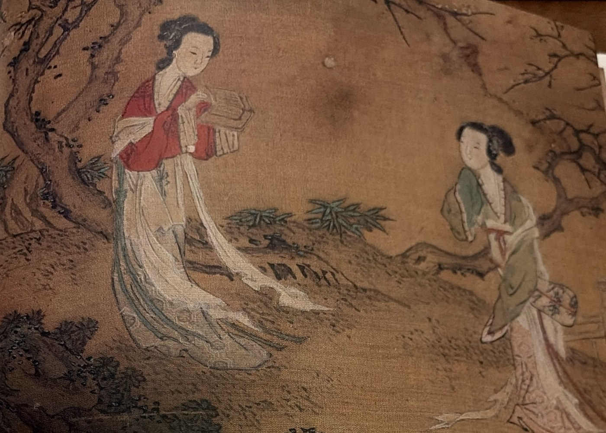
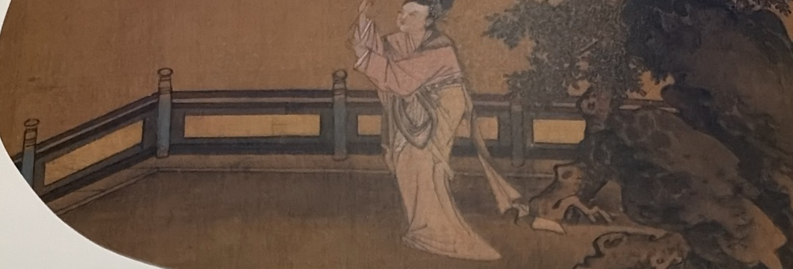
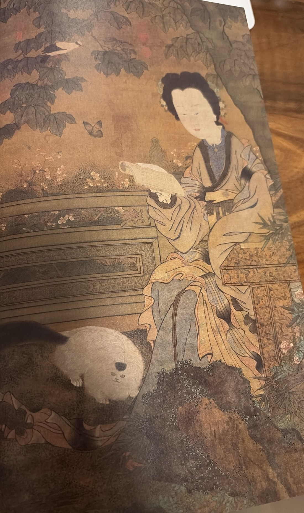
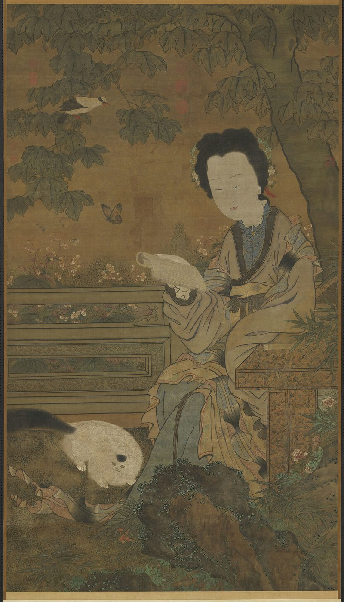
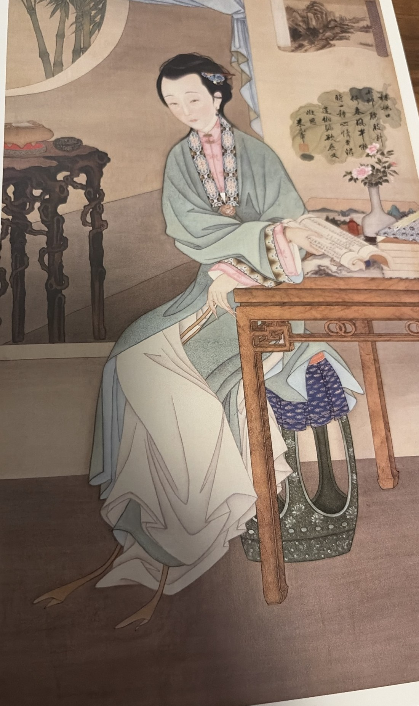
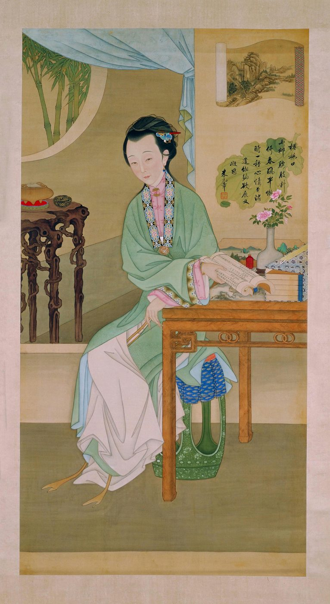
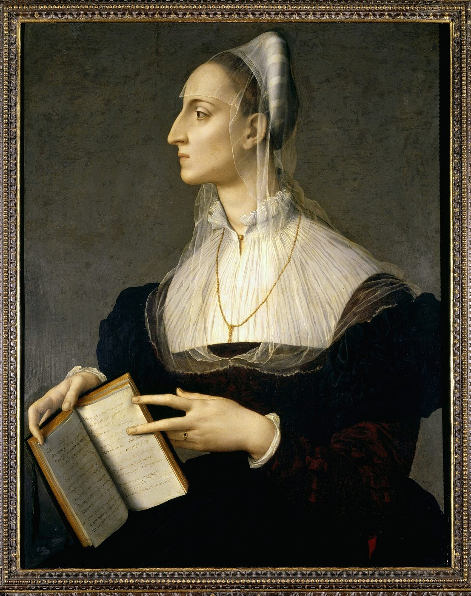
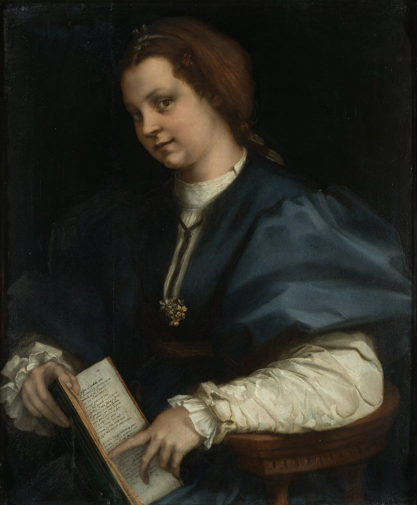

# 从“画中书”到“画中人”

## 读书图的读法

文 / 张波

> **整理说明。** 本文据书页照片逐页转录，尽量保留原刊用字、标点与诗题符号（如〈〉与《》并用）。页码依原刊。照片有斜视、反光或边缘被切处，看不清的字作「□」；少数被切掉而可用上页残句或作者本人已刊合法文本补出的字，在句中用【】标出，并在文末《校对备注》说明，不暗改。图5、图6、图7、图8的整页图版，用户未拍到；图7、图8另附馆藏公开预览（压缩），不以之冒充原刊图版。正式刊名、年期尚未检索到可核对的目录，见 `SOURCES.md`。

---

在明清时代的视觉文化消费品类中，美人画、美人像、美人图一类作品的大量出现，既是对传统人物画中“仕女图”形态的仿制和复制，也在某种程度上丰富了其形态的多样性，并无可避免地带来一些审美趣味的波动。对这种水平一般、无名无款的世俗绘画进行审美界定，行家里手往往不屑为之，但也不乏美术史研究者出于自身种种偏好，从这类作品背后发掘出其中隐藏的价值。

其中一个让笔者深感兴趣的问题是，读书图像作为仕女图、美人画中的一个题材，能否代表一种比较超脱的、高级的、带有文人色彩的审美趣味，成为世俗绘画中的一股清流？而这类和读书有关的图像，是否有和读书有关的读法（图1）？

像这样一帧明代的佚名仕女图，我们可以直观感受到，在构成仕女活动图景的所有程式物象中：花木、青石、苔藓、阑干、团扇、书卷……可以传达寓意的并非只有书籍。自然景观、物候节气乃至女性心绪，都有特定的物象承载其意义。如画中绿衣仕女手持的扇面向我们显示了画中的季节是暮春至初夏，她的身体似乎倚靠着身后的桃树，而枝头的粉白色花朵已经显得疏落。单看画面的这一部分，似乎是对宋代刘松年仕女图的模仿（图2）。

你可以看到几乎所有的物象都是程式化的统一，花木石栏，仕女图的基本元素，居于画面中心的是那把团扇。它的象征意味非常明显：季节流转，韶华易逝，宫廷中的无名氏，她们的命运是相似的。

但是，图1左侧红衣仕女手中的书籍，却将整个画面带向了更加幽远的意境。画者用书籍（虽然是无字的）在画面中构建了两位女性的无声交流空间，也搭建起画中人与观赏者之间的沟通渠道，使仕女图中的景象不再是纯然的萧寂，也使我们对画中人的理解不再局限于心绪。在这一意义上，读书图中的书籍（及文字）拥有其他物象不具备的力量，它在召唤我们对程式化的图像产生更多的感受。我们不禁想要知道：她们是谁？她们有什么故事？

尤其是，当仕女图中的书籍代替团扇成为画面的中心，再繁复的物象组合都显得意义单调（图3）：梧桐树叶茂密，枝上停落着一只鸟儿，似是白头翁；汉白玉栏杆后，花圃里月季盛开，蝴蝶飞舞；青石一侧，牡丹盛开在竹叶中；美人的裙摆衣裾间绣鞋若隐若现，她的脚边还有一只肥猫……饱满到溢出画面的春天。唯有她手中这卷展开的，却没有文字内容的书，能让观者有更多的联想余地。

放大画面细节可以发现，画中的书虽然没有文字，但是却有行格界栏，乃至黑色的书口。这种对书籍的具象描绘显示了它作为画面物象的真实存在属性，也就是说，书籍和画面中的植物、动物、景致陈设一样都是有现实参照的。而对书籍所做的真实性探究却比识别画中的草木鸟兽之名更有吸引力，因为只有它能够带动观者对画中人产生更深层面的理解，所以观者最渴望揭晓的谜题应该是：画中人在读什么书？继而由这个问题来判断，画中人是谁？

这幅画虽然没有画出书中的文字，但还是给了我们不少想象空间。我们首先注意到，画中人的视觉焦点并不在书页上，也就是说她此刻没有在阅读，而像是在神游，或者是思考，也许是走神。而她的左胳膊搭在庭院中长条案几的一角，衣袖之下压着另外两卷书。

**图1**（明）佚名《仕女图》册页，绢本设色，12.7cm×17.1cm，美国大都会美术馆藏

**图2**（宋）刘松年《刘松年真迹》册（八开之一，《桃花仕女图》页）
绢本设色，14.2cm×24.9cm，台北故宫博物院藏

这幅仕女图旧题五代周文矩作，但很多学者都认为与之风格不符，当为伪托之作。高居翰先生认为这幅画有可能是清初画家禹之鼎的作品。1禹之鼎精于肖像写真，为当时很多名公巨卿绘制过肖像。尤其值得一提的是，他善于将文人肖像置于书斋场景，用书籍、笔墨、文玩等古物渲染像主的生活环境。著名的例子如《乔元之三好图》（南京博物院藏），画中除了肖像主人外，左侧绘有三名奏乐侍女，像主身后的桌案上书籍堆积如山，画面右侧则是两名侍女提着一个巨大的酒坛。此画以乐、书、酒象征“三好”。再如《乔莱书画娱情图》（南京博物院藏），乔莱的身后是垛叠整齐的书架，面前长案上摆放着文房四宝和一卷打开的书籍，身旁的童子正用架子高举一幅展开的江南山水图轴供他观赏。主仆二人的前方还有置画的矮几，等待来客的风泥茶炉、茶具茶器。由此看来，文人士大夫热衷的、体现当时鉴藏文化趣味的书斋写真肖像，它们在明清时期的流行很可能是书籍元素出现在仕女图、美人画中的原因。

禹之鼎在清康熙二十年（1681）官鸿胪寺序班，以画供奉入畅春园。他的人物画表现方式很可能开启了某种范式，或引发了宫廷画家之间的某种程度上的技艺竞争与较量。就笔者所见，有三幅女性读书图像，其图式渊源都可以追溯到这幅疑似禹之鼎创作的《仕女图》。接下来要讲的三幅画，将会揭晓观者所渴望的答案，不仅图中的书籍可以找到实物对应，而且书页上的内容也从无字进化为有字，从而将书籍作为画面物象的功能性提高到前所未有的高度。

> 1　高居翰先生根据一幅相似构图画作推断此画可能是清初画家禹之鼎的作品，参见 James Cahill, *Pictures for use and pleasure: vernacular painting in high Qing China*, University of California Press, 2010, p. 181.

**图3**（五代）周文矩《仕女图》轴，绢本设色，180.9cm×102.1cm，台北故宫博物院藏

另附馆藏公开预览（压缩，非正式原刊图版）：

---

## 一　画中书：当书籍选择成为表达策略

与《仕女图》相比，《胤禛围屏美人图》（又名《雍正十二美人图》）和《春闺倦读图》的阅读场景由室外转向了室内，但关于书籍的几个要素全部保留了下来：画中女子手持一册书，视线游离于书卷，处于由阅读引伸出的遐思状态；倚靠的桌案上放着书函，说明画中呈现的是整部书籍。更进一步的是，画面中的书籍文字可以辨识，从而可以找到对应版本的书籍实物。2

这两幅画中的女子读的是同一部诗集《名媛诗归》。《名媛诗归》是一部晚明时期的诗歌总集，所选为上古神话人物至明代的女性诗人的诗歌作品，每首诗末附有著名诗学家钟惺、谭元春二人的评点。

这两幅作品的尺寸与《仕女图》（180.9cm×102.1cm）相当。《胤禛围屏美人图》是圆明园深柳读书堂围屏上拆下来的美人绢画十二张之一，纵184厘米，横98厘米；《春闺倦读图》则是纵175厘米，横104厘米的绢本立轴。真人大小的尺寸表明了画像在创作时就被规定好的实用功能，而悬挂展示的实际需求又从内在推动了程式化的创新。但从创新的力度而言，两幅画看似构图十分接近，尤其是画中书第一次显现了真身全貌，具有了可读性，但如果仔细辨析，二者在使用书籍传达画面内涵这一层面还是有着较为悬殊的差别。

在第一幅画中，展开的书页上是〈闻夫杜羔登第〉〈青溪小姑歌〉〈金缕词〉三首诗（图4）；《名媛诗归》原书中，〈闻杜羔登第〉在卷十、〈青溪小姑歌〉在卷六、〈金缕词〉在卷十五。画面中的三首诗经过了挑选和刻意安排，用来构造画中人情绪的层次感，因此摘抄时变动了次序。这三首诗中，〈金缕词〉是画中书的视觉中心，也是承担主要意义的诗，它是导致画中人从书中游离的根源。但是在《名媛诗归》原书中，〈金缕词〉却恰好不在书的同一面，因为虽为同一页，但沿版心对折装订成书后，实则是两面，因此画作者要将原文合并。而诗后的双行小注，画面也无法全部体现，只保留了其中一行，原书的注是每行七字，但画作者为了和〈青溪小姑歌〉的诗后注保持平衡，所以变成了八个字。

桌案上的书函没有书名题签，再加上诗歌次序的错乱，“画中书”实际上在画面中形成了一个谜题：首先将观者吸引到书中的文字，在读到“花开堪折直须折，莫待无花空折枝”的诗文时，并不止步于这一首诗的涵义，仍可继续探究〈金缕词〉之前的两首诗，经历画中人的阅读体验，并最终体会到画中人的思绪。书籍在这幅画中的作用是多层次的，它甚至还与画中人身后悬挂的画作相呼应。画中题款米元章的“缃编欲展又凝思”实际是胤禛本人的诗文，而这又似乎点出了整幅读书图的主题。

研究者普遍认为《胤禛围屏美人图》是雍正皇帝在亲王时期与宫廷画师的共同创作，我们可以想象创作这十二幅美人图像的过程，对画师来说是富于挑战性的。这意味着画

> 2　对画书籍实物的分析详见笔者所撰：〈画中美人读何书〉、〈画中美人读何书〉（续）、〈画中美人读何书〉（再续），分别发表于《古典文学知识》2017 第1期、2018 第1期、2019年第1期。

**图4**（清）佚名《胤禛围屏美人图》轴（《雍正十二美人图》轴·十二屏之一，《托书纸吟》），绢本设色，184cm×98cm，北京故宫博物院藏

另附馆藏公开预览（压缩；馆方及通行题名作《观书沉吟》／《美人展书》，与本文图注《托书纸吟》不同，不据之改图注）：

**【缺页 49–50】** p.48 正文末句“这意味着画”与 p.51 起句“师必须尝试”可以衔接，故这两页应为图版。照片中有图4整页，无页码；文中图5（《春闺倦读图》）的整页图版未见，当在此两页之一。

师必须尝试在各个微观层面突破已有的美人图像程式，进行自觉的创新。而具体到读书图这一范式，画师将选择书籍、选择诗文、呼应文字的整个过程作为一种崭新的表达策略，创造性地拓展了画面的内涵。

与之相比，第二幅画则没有这么曲径通幽的过程，桌案的书函上可以直接看到“媛诗归”三字，使通晓诗文的观者一望而知“画中书”的名字，而书籍卷起仅留一只手可持握的大小，观者只能看到一首诗，且诗文大部分被女子的手指遮挡（图5）。

书页上是《子夜歌》的第一首。原文为：

> 芳是香所为，冶容不敢当。
> 天不夺人愿，故使侬见郎。

书卷显示的文字在《名媛诗归》卷三最末。“子夜”题下小字云：“子夜，晋女子也。尝造曲，声过哀苦，因有四时行乐之词，谓之子夜四时歌。”诗句后的双行小字为谭友夏评语。“芳是香所为”后为“谭友夏云香奁中入细佳语”。“冶容不敢当”后为“谦得不情妙”。后一句末为“谭友夏云感天妙。感天只在不夺人愿，感得痴。”此诗末还有一句总评：“谭友夏云女郎有极夸口语，有极谦让语，总之，遇有情人，夸口亦妙，谦让亦妙。”但这些真实内容在画面上几乎全部被舍弃了。

对比书籍实物可以看到画面虽然原样显示了书籍原貌，但是将书页文字部分减少、遮挡到只剩下“芳是香所为”、“冶容不敢当”这两句诗。这说明书籍在这幅画中的作用只是一个道具，它只用于呈现非常表面的文字意义。两句诗文配以画中人的表情，加上她似站非坐的斜倚姿态，以及书卷后裙裾的曲线、书案上的佛手和脚边的狸纹，又让这幅画陷入到一种较为色情的情调中。

此画的背景中也有一小幅山水，这一“画中画”的落款是“甲辰冬日画，冷枚。”与画中书的文字没有关联，而更像是画家为自己选择的署名处。值得注意的是，不少学者认为冷枚参与过《胤禛围屏美人图》十二幅的创作。据聂崇正先生考证，画中甲辰冬日乃雍正二年甲辰（1724），此时冷枚已经不再供奉内廷（见〈清宫廷画家冷枚其人其作品〉）。因此这是一幅受到《胤禛围屏美人图》影响，但实际产生于宫廷之外的作品。可以看出，这幅画与第一幅仅有形似，实则没有投入任何创作意志，画中没有谜题，书中没有设问，虽然画面依旧精致，但内容细节的呈现却显得敷衍。这很可能是冷枚拿宫廷中的新样投入的商业生产活动，用来应付市面上一般的达官显贵。这也是为什么该画虽以书卷为中心却又重新出现了佛手、动物等人们熟知的色情暗示物象，甚至连画中人的姿态也悄然变化，不再端庄。

第三幅画的情况则更复杂一些。该画现藏美国弗利尔美术馆，原题“宋盛师颜闺秀诗评图”。根据该馆中国书画策展人安明远先生（Stephen D. Allee）的研究记录，此图为绢本设色，尺寸为134.8cm×86.2cm。画中书上的文字清晰可见，书页上录有四位女诗人的名字和诗作，依次为：〈竹枝词〉，朱静庵；〈春日襍书〉，朱淑【右端被切，据上页残句与作者〈画中美人读何书（再续）〉补：真；〈惜春花〉，鲍君徽；〈牡丹〉，】薛涛。画中书的封面题着“闺秀诗评”四字，但现存题名《闺秀诗评》的几种书，都不包含画中出现的这四首诗。

经笔者研究，画中书对应的书籍实物是明末崇祯年间杭州进士刘士鏻辑选的《闺秀诗评》。此书和《名媛诗归》类似，选录历代女诗人诗作，但它并非单独刊行的一部书籍，而是从属于刘士鏻辑录的古今文章选集《文致》的其中一个版本的附录当中。

《文致》是晚明非常流行的小品文读本，其传本甚多。主要有三个版本系统：其一是《文致》不分卷，印刷精美，乃著名的吴兴闵氏朱墨套印本；其二是《兰雪斋增订文致》八卷；其三是《删补古今文致》十卷。每个版本系统中又可细分若干刊行年代不一的版本项，但刊行时间皆在明末天启、崇祯年间。其中，包含《闺秀诗评》的只有八卷本《兰雪斋增订文致》（图6）。

除了书名对应的复杂性之外，画中诗文的呈现也展现了多重内涵。首先，画中展现给观者看的那一页书，是画中人还没有读到的部分。

我们看到的第一首是《竹枝词》。诗作者朱静庵生活在明代成化、弘治年间。《历代妇女著作考》中所列文献对朱静庵的评价甚高：“静庵博学高才，遗文垂后，才识纯正，词气和平，笔力雄健，真闺门之遗范，女德之文儒也。”“有集藏于家，平生妇德，冰清玉洁，朱淑真李易安不足多也。”而《闺秀诗评》所辑录的朱静庵生平却于家世、才华之外，突出了这样一点内容：“亦以所配非偶，每形诸咏。”说她没有嫁给德才相配的如意夫君，平时会将这种不平心绪写进诗中。

回到画面中，首先印入眼帘的就是“鸳鸯不成浴”，而全诗是：

〈竹枝词〉朱静庵

> 横塘秋老藕花残，两两吴姬荡桨还。
> 惊起鸳鸯不成浴，翩翩飞过白蘋滩。

第二首诗看上去是一首普通的春日即兴抒情，然而她的作者却有着更加令人同情的命运。

〈春日襍书〉

> 自入春来日日愁，惜花翻作为花羞。
> 呢喃飞过双双燕，嗔我帘垂不上钩。

〈春日襍书〉的作者朱淑真，和朱静庵一样是浙江海宁人。“早岁不幸父母失审，不能择伉俪，乃嫁为市井民家妻，一生抑郁不得志。故诗中多有忧愁怨恨之语。每临风对月，触目伤怀，皆寓于诗，以写其胸中不平之气。竟无知音，悒悒抱恨而终。”（魏仲恭〈断肠诗

**【缺页 53】** p.52 引文止于“魏仲恭〈断肠诗”，p.54 始于“前集序〉”。中间至少缺该序出处的后半。图6（《兰雪斋增订文致》书影）整页图版亦未见，或在此页。

前集序〉）《闺秀诗评》中亦以极简笔墨总括为：“文章幽艳，才色清丽，因匹偶之非伦，赋断肠集十卷以自解。”

这首诗的“双飞燕”和上一首的“鸳鸯”意象互相照应，似乎显示着这两位身处异代却同籍、同姓的才女之间某种情思的关联，即无论是成为有社会地位的儒者的妻子，还是嫁给一般的凡夫俗子，都有可能遭遇“所配非偶”的婚姻；女性的才华虽能彰显于后世，而于当时则绝少知赏者。这也反映了明清时代众多以诗才闻名的名媛闺秀们某种共同的“困境”。这种对女性命运的洞察和对女性才情的理解本来很难借助程式化的美人图像表达出来，然而画作者却通过对画中人所读之书的甄选和对文本的精心选择微妙地传递出其中的意蕴。

在两首异代的浙江籍女诗人之后，画作者选择了两首唐诗，一首做了大篇幅的删节，而另一首仅仅出现了一个题目。

〈惜春花〉

> 枝上花，花下人，可惜颜色俱青春。
> 昨日看花花灼灼，今日看花花欲落。
> 不如尽此花下欢，莫待春风总吹却。
> 莺歌蝶舞媚韶光，红炉煮茗松花香。
> 妆成吟态恣游乐，独把花枝归洞房。

〈惜春花〉的作者鲍君徽，字文姬，唐德宗时曾入宫，与侍臣倡和，今存诗仅四首。画面中截取的仅仅是原诗的最后两句，也即“不如尽此花下欢”的具体情景：莺歌蝶舞，烹茶品茗，赏花妆扮，携春归去。总体而言，〈惜春花〉全诗带有某种春华易逝的咏叹声调，而画中截取的两句却具有鲜活的、当下的生命气息。

第四首诗题《牡丹》也很值得注意。该诗的正文并未在画中出现，姑录如下：

> 去春零落暮春时，泪湿红笺怨别离。
> 常恐便同巫峡散，因何重有武陵期。
> 传情每向馨香得，不语还应彼此知。
> 只欲栏边安枕席，夜深闲共说相思。

虽然题为牡丹，但是全诗并未出现花的直观意象，只是起句点明了花落之时、离别之思。与前三首出现于画面中的诗相比，没有那么直露，而是具有内敛的涵咏意味。此诗无形中承载了画面意蕴的内在指向：何为理想的男女之情？恐怕是相见时“不语还应彼此知”的情谊，心心相印的感知，以及经历了离别再相见时那种历经沧桑，却还能“夜深闲共说相思”的悠然淡泊。

很难忽略的一点是，与前两幅图相比，这幅画中的女子面相天真，表情愉悦，似乎未经世事、没有离愁。她的腰间戴着一枚由两种颜色的结绳上下相连接的玉连环，这只玉佩显示女子已经有意中人或者已经订婚。正如明代杨循吉写的〈玉连环〉诗：“都作连环钩结相，不教花片逐春风。”她期待美满的婚姻，她的生活是当下的，对她而言全新未知的，书页中历史上女诗人们已经有过的咏叹还在她的视线之外。妻子之思、宫人之劝、风尘之叹，不同身份的女诗人都在画面中等待向画中人诉说。

不难发现，第三幅画与第一幅画相同，画面中的书籍和书页上的诗文都是带有选择策略和表达意图的呈现结果，在书籍实物中，这些诗作并不在同一页。再次强调这一点，因为这表明书籍在画中的出现已经不仅仅是写照空间、环境和陈设中的一个普通道具，而是充分蕴含并体现创作者野心的载体。要深刻理解这种野心，我们不妨将视野投向中国传统绘画以外的地方。

---

## 二　画中人：当书籍内容成为画面中心

我们将要引入两幅“画中书”象征意味明显的文艺复兴杰作。其一是意大利女诗人劳拉·巴蒂费里肖像。通过接下来的分析，读者将会发现这幅相当于中国明代嘉靖年间的女诗人肖像与明清时期中国的美人读书图像有很多共性（图7）。

阿尼奥洛·布龙齐诺画的这幅《劳拉·巴蒂费里的肖像》给我们最直观的印象，是呈现给观者的只有画中人的侧面脸庞。与三幅中国读书图中的“画中人”一样，劳拉·巴蒂费里也没有直视观者。但是，她挺直的长脖颈和褶皱处的白纱高领，带给人一种高贵冷漠而又疏离的感觉；而此前三幅画中的中国美人则颔首浅笑，虽也未曾直视观者，但显然带有某种被关注的愉悦。

这幅画有一处明显的身体语言，即画中人的两根修长手指将画中书的页面固定，并具有引导意味地将观者的视线聚焦在书页上，从而使“画中书”成为整个画面的视觉中心。画中书的文字是可读的，西方不少艺术史研究者都对这幅画中的书籍进行过深入的探索3。为行文之便，笔者将概况归纳如下4。

作者布龙齐诺（Agnolo Bronzino, 1503–1572）出生于佛罗伦萨，人生大部分的职业生涯是在美第奇家族担任宫廷画家。此外，他也是一位诗人，在当时佛罗伦萨的文人圈十分活跃。

画中人劳拉·巴蒂费里（Laura Battiferri, 1523–1589）是当时佛罗伦萨最有名的女诗人。这张肖像画大约作于1560年，这一年，她在佛罗伦萨出版了自己的诗集，其中收录了187首诗作，包括与她通信、有诗歌酬唱的41首男性诗人的作品，而布龙齐诺也是其中之一。

> 3　Megan Osler: Laura, Laurel, Lauro: Bronzino and Mannerist Depictions of Exemplary Women https://dalspace.library.dal.ca/server/api/core/bitstreams/35f5d879-2e40-4fd0-8bd3-16086650ef56/content
>
> 4　Cristina Vansco, “Laura Battiferra: An Open Book”, *Carte Italiane*, vol. 5(2009), pp. 23-34.

**【缺页 56】** p.55 止于劳拉诗集与布龙齐诺的交游，p.57 另起“画中书页上也是诗歌……”，中间当为图7整页图版。原刊图版未见。以下为馆藏公开预览（压缩），仅供对照，不替代原刊图版。

**图7**　阿尼奥洛·布龙齐诺《劳拉·巴蒂费里的肖像》。（原刊图注因整页图版未拍到而不存；题名从正文。）

画中书页上也是诗歌，但并不是画家或画中人的创作，而是引用了彼特拉克（Francesco di Petracco, 1304–1374）的十四行诗。据研究表明，画中的两首诗分别来自彼特拉克诗集的第64首和第240首。也就是说，在彼特拉克诗集版本中，这两首诗不在同一页面。它们是诗人兼画家的作者选择出来的两首诗。

想要进一步理解这幅画，我们需要先理解这么几个问题。首先，十四行诗“Sonnet”是起源于13世纪意大利的诗歌体裁，之后传布到欧洲各国。因为诗人彼特拉克将这种体裁的创作推向了一个高度，故意大利的十四行诗也称为“彼特拉克体”。（相对应的是英式十四行诗，称为“莎士比亚体”。）彼特拉克被称为“人文主义之父”，他的诗歌集（意大利文 *Il Canzoniere*，英文 *Song Book*）收录了他写的366首诗，其中317首是十四行诗。沿袭他创作风格的文艺复兴诗人对他的作品十分推崇，因此产生了不少装饰精美、装帧考究的手抄本、注释本，流传至今。

可以说，无论是画家布龙齐诺还是诗人劳拉·巴蒂费里，他们的创作也都是十四行诗，与彼特拉克风格相近，并存在文字、意象的反复引用。因此，画中所呈现的诗歌，既是一种创作层面的文献引用，也是一种诗歌风格的传承，更是由此向前辈诗人彼特拉克表达致意。

另外更重要的一点是，彼特拉克有一位缪斯，名叫劳拉（Laure）。相传1327年，这位劳拉在阿维尼翁的圣克莱教堂演奏，由此激发了彼特拉克的创作。虽然他们从未见面，但彼特拉克在诗歌创作中，多次表达了对劳拉不求回报的爱恋和思慕情绪，且终身未婚。1348年，劳拉去世，彼特拉克在《给后人的信》中写道：“我年轻时，曾一直和那无法抵抗的、但是纯洁的，我唯一的爱，斗争。”此外，彼特拉克的诗中之所以有一个核心意象，即罗马诗人奥维德《变形记》中达芙妮拒绝太阳神阿波罗的爱情并化作一棵月桂树（Laurel），也是因为这个词与他的缪斯劳拉“Laure”接近。

而劳拉·巴蒂费里的名字 Laura 与彼特拉克的缪斯 Laure 也相近，所以这里又存在着另外一层涵义：画家布龙齐诺借由书籍内页文字对彼特拉克的引用来表达劳拉·巴蒂费里是自己创作的缪斯，并且既是绘画意义上的，也是诗歌意义上的。研究者已经阅读了劳拉和布龙齐诺围绕肖像画的创作而写就的一系列十四行诗，证明了他们之间在创作层面确实存在着互相欣赏的友谊。

当对这些背景知识有了基本了解之后，再看这幅肖像，就可以知道画中书是画家精心设计的智力游戏。画中人的引导将观者的视线引向书页上的两首十四行诗：

> 如果你能以任何愤怒的姿态
> 低下头，或弯腰，或比任何人都更快地逃离，转过脸去，向我虔诚而值得
> 敬仰的祈祷
> 如果你能以此或其他任何计谋逃离我的怀抱，那里爱从最初的月桂枝上嫁
> 接出无数枝条，我会说，这便是你轻蔑我的正当理由；
>
> 因为一株高贵的植物显然不属于贫瘠的土地，因此
> 它自然乐于离开那里：
> 但是，既然你的命运不允许你去别处，至少要小心，不要总是停留在令人
> 憎恶的地方。
>
> （彼特拉克十四行诗第64首大意）
>
> 你拥有那颗令上天闪耀的心
> 拥有如此清澈的智慧，如此崇高的美德
>
> （彼特拉克十四行诗第240首大意）

布龙齐诺并不是第一个在画中引用彼特拉克诗集的人。比他更早的另一位佛罗伦萨画家安德烈亚·德尔·萨托（Andrea del Sarto, 1486–1530）在1528年创作了一幅肖像，今天人们称之为《手持彼特拉克诗集的年轻女子像》（*Portrait of young woman with a Petrarch*, 图8）。画中人名叫玛利亚·德尔·贝雷达约（Maria del Berrettaio），是画家的妻子卢克雷齐亚（Lucrezia）与前夫所生的女儿。

玛利亚手中的书卷也是彼特拉克《歌集》（*Il Canzoniere*）。画中书页上的诗句是该集第153首和第154首。这相联的两首诗，表明画中如实呈现了书籍页面的真实状况。

> 或许无法完全表达，但通过你，
> 我此刻的忧愁和阴郁，
> 与她平静安宁的境遇形成鲜明对比。
>
> （第153首片段）
>
> 这作品如此高贵、优雅、罕见，
> 凡人的目光无法完全领略：
> 她眼中的美丽如此深邃，
> 爱如甘霖般倾泻而下，温柔甜蜜。
>
> （第154首片段）

这是两幅西方艺术史研究者喜欢拿来相提并论的图像，虽然创作时间相差了三十余年，但都诞生于文艺复兴时期的佛罗伦萨，出自服务宫廷与贵族客户的艺术家之手，那么其创作范式存在继承、模仿和超越的可能性。安德烈亚画中的少女直视观者，手指书页的同时，眼神带有挑衅意味，仿佛是对观者的智识提出了考验。再结合诗文的内容“这作品如此高贵、优雅、罕见，凡人的目光无法完全领略”，既是画家对自身创作力的自信，又对观者的鉴赏能力提出了质疑。这本质上，是画家通过画中人，并借用书籍内容，与观者进行的一次较量和互动。

（p.58 正文止于“与”，末页起句为“观者进行的一次较量和互动”，二者可衔接。末页照片未见页码，按其顺序当为 p.59。）

（图8原刊整页图版未见。以下为馆藏公开预览，压缩，不替代原刊图版。）

**图8**　安德烈亚·德尔·萨托《手持彼特拉克诗集的年轻女子像》（*Portrait of young woman with a Petrarch*）。（原刊图注因整页图版未拍到而不存；题名从正文。）

再看布龙齐诺的作品，画中人呈现疏离的高贵感，不与观者互动。而画家则对书籍内容的呈现做了精心的安排，选取了两首不在同一书页中的诗歌。仔细体会诗文内容就能得出结论，这是画家通过画像的创作、诗文的交流与画中人进行的一场对话，并不需要观者的参与。他将劳拉比作高贵的植物，而他笔下劳拉挺直身躯的形象也呼应了诗文传递出的坚定的、清澈的、崇高的力量。他用彼特拉克的诗文向自己的缪斯倾诉，表达对劳拉、对诗歌的崇拜之心。可以说，布龙齐诺是借用了前辈画家的构图程式，让书籍内容成为画面意义建构与表达的手段，而他实际在做的，是用绘画语言向诗歌艺术致敬。

回到中国传统绘画中的仕女读书图，虽有书中文字的巧妙安排，但画中人到底是谁？这始终是难解之谜。而与此同时，画师的创作野心似乎也是隐晦的。但至少我们已经看到，在中西方艺术史上，曾经出现过大致同样的探索路径，即画家从书籍中寻找灵感，丰富画面的表意空间和表达内涵。

新的画法必然伴随新的读画之法。画中书的出现，建构起一种画中人与画外人的均势较量，要求观赏者鉴赏力的匹配，在观看读书图时，兼具读画与读书的能力与想象力。这种读画之法，不同于阅读传统的绘画题跋、款识，而是精细辨识画中物象的细节，探寻画中是否暗藏未被发掘的涵义，通过书籍文字去想象和猜测，以求实现更多的审美期待。如若尝试这番新的读法，则有望打开一层新的境界，寻常过眼观画时那些隐藏画中的神秘线索将对你悄然显现。

---

## 校对备注

1. **转录范围。** 正文、小标题、引诗、图注、脚注均据 `/workspace/zhangbo-huazhongshu/pages/` 下 13 张书页照片转录。未从盗版站整篇搬运。作者先前在《古典文学知识》所刊〈画中美人读何书〉系列，仅用于核对其本人已发表过、且本刊此页被切去的个别诗题与人名，并已标明。
2. **页码与缺页。** 可见页码：44、45、46、48、51、52、54、55、57、58。图3、图4整页图版及末页均未见页码。图3夹在 p.46 与 p.48 之间，定为 p.47（有图，非缺页）。p.48 与 p.51 正文可衔接，故 **p.49–50 缺图5整页（图4或即其中一页）**。**p.53 缺正文**（及可能的图6图版）。**p.56 缺图7整页图版**。末页当为 p.59。图8整页图版亦未见，所在页次不能从现有照片确定（也可能在正文尚未拍到的位置，但 p.58 已点出图8，其后直接进入收束，故更可能是独立图版页而未被拍摄）。
3. **补字。** （a）脚注1英文书名首行作 *Pictures for use and*，次行起 *pleasure: vernacular painting in high Qing China*，照片中 and 可见，未补字。（b）p.52 首页第一行右端被切，据 p.51 句末“四位女诗人的名字和诗作，依次为”及作者〈画中美人读何书（再续）〉补“真；〈惜春花〉，鲍君徽；〈牡丹〉，”。（c）其余看不清处未猜。
4. **保留原刊用字，不据通行写法暗改。** 包括：〈闻夫杜羔登第〉与后文〈闻杜羔登第〉两见；〈春日襍书〉（不作“杂书”）；刘士鏻；“将概况归纳如下”；“风泥茶炉”；Francesco di Petracco；Laura Battiferri；脚注4作 Cristina Vansco（正式发表作者为 Cristina Varisco，见 `SOURCES.md`）；图4题《托书纸吟》（馆方及通称或作《观书沉吟》《美人展书》）。
5. **图注与馆藏。** 以原刊图注为准。馆方尺寸、题名如有出入，只在 `画作清单.md` 与 `SOURCES.md` 备忘，不改文稿图注。未编造未见的馆藏编号。
