# 以谱解画

## 读李衍《四清图》

文 / 伍梓维

> **整理说明。** 据用户所拍 14 张书页逐字录入。封面所印即上列三行，作者名在正文与图注中一律作「李衍」，不改为馆方通行的「李衎」。原刊用字、标点、书名符号（〈〉与《》并用）、着录与引文起止，尽量按页保留。看不清的字用「□」；本包未见需要用「□」的位置。被切掉而可据上下页残句补出的字，用【】标出——本稿无此类补字。缺页见文末《校对备注》与 `README.md`。图注以原刊为准；馆方题名、尺寸或编号如有出入，只写在备忘，不改图注。正式刊名、年期尚未落实。未找到可合法阅读的全文，故无「不出自照片」的段落。插图先附照片裁切，有馆藏预览者另附，并标明来源。

---

## p.84（`pages/01-3a6e12ea538d.jpg`）

中国画竹，始于南北朝，初为点缀。至唐五代，或描摹窗上竹影，或以墨竹画壁，仍重形似。及宋，墨竹始立门目，并以文同开派，寓士人高格于笔墨意趣。逮乎元代，墨竹盛行至鼎，笔墨逸兴外更臻于理论自觉。生活于元初的李衍，正是这样一位承前启后、知行合一的画竹大家：其画深研物理，气韵清绝；其著《竹谱详录》，首度集画法、格物、考据、比德于一体，为画竹确立了完备的学理与法度，引观者由形入神，体悟其道。

### 一

李衍（1244–1320），字仲宾，号息斋，蓟丘（今北京市）人。早仕浙江行省，累迁至吏部尚书、集贤殿大学士，并授荣禄大夫。晚年因病辞官，寓居维扬（今江苏扬州），卒后追封蓟国公，谥号文简。善作竹石枯槎，画竹师法南唐李颇，墨竹则承自文同（1018–1079），并启同代之吴镇（1280–1354）。

《四清图》（图1）是李衍现存可知明确纪年的最早作品，亦是其墨竹画作之代表。卷后画家自题赫然在目，以行书书寸半大字十行，笔意从容，娓娓道出作画本末，自谦之余一派文雅：

> 大德丁未（1307）秋九月，王玄卿道录送至此纸，求予拙笔，事多未暇。明年春正月一日，始得了办，灯暗目昏，白日视之，不知何如也。息斋道人蓟丘李衍仲宾题。

后押“李衍仲宾”白文印，“息斋”朱文印。从中可知此卷画就于1308年，彼时李衍已及花甲。题后又见明代吴门中人周天球（1514–1595）跋，以清润之辞写雨后观画之澄心，以诗意之笔评李衍墨竹之逸韵：

---

## p.85（`pages/02-2d30c6bb86a9.jpg`）

> 乙亥（1575）二月六日新雨洗宿霾，研几生润，余在都城南李银台琦斋中获观息斋尚书此卷，真是风籁泠然，尽去胸次尘垢，东华马上郎恐不能得此清思也，莞尔识之。六止生周天球。

徐邦达据此跋语推断周天球题写时似已不省其为不全本，¹则此卷或于1575年前即被拆分作长度大致相等的前后两卷。前半卷末添“仲宾为玄卿作”六字伪款，传至民国，1948年经文物贩子卢芹斋（1880–1957）售与美国堪萨斯城纳尔逊—阿特金斯艺术博物馆，名为《墨竹》。后半卷据其上所钤收藏印可知，明中叶以后，此本递藏脉络较为清晰。“天籁阁”朱文印，“项叔子”白文印，“项墨林鉴赏章”白文印，“子京所藏”白文印等均显示其在李琦之后为明嘉靖、隆庆年间的大收藏家项元汴（1525–1590）所蓄，而画心起首处至李衍跋后多方项元汴完整的骑缝印也可确证此图在入藏天籁阁时已被分作两卷。画首与李衍跋前各有“樵李氏鹤梦轩珍藏记”朱文印一方，此印则昭示后半卷继项元汴之后，转归李日华（1565–1635）度藏。

明清易代后，后半卷为乾隆朝（1736–1795）以前“甲于海内”的收藏巨擘安岐（1683–？）所得，并着录于其《墨缘汇观录》一书中，名作《竹梧兰石四清图》，故卷上又可见“安仪周家珍藏”朱文印与“安岐之印”白文印各一。乾隆年间则被进献入清宫内府，钤盖“乾隆御览之宝”、“石渠宝笈”与“宣统御览之宝”、“宣统鉴赏”四方朱文印。

清末国运维艰，末代皇帝溥仪（1906–1967）以赏赐为名，盗运大批清宫旧藏珍品北上至长春伪满皇宫，此卷亦在其中，与其它清宫遗珍一同秘藏于皇宫东院内一座俗称“小白楼”的灰白色二层砖楼中。1945年，日本战败，伪满州国政权随之覆灭，溥仪仓皇撤离，小白楼则被留守伪军发现后惨遭哄抢与破坏，无数瑰宝星散，其中部分流入古玩市场，成为所谓的“东北货”，此即震惊全国文物界乃至文化界的小白楼事件。李衍此图后半卷自伪满皇宫流出后，经古董商郭凤璋售予“湖社画会”的骨干成员惠孝同（1902–1979），并由惠氏上交至国家文物局，今归北京故宫博物院典藏，²名为《四清图》。

### 二

美国纳尔逊—阿特金斯艺术博物所藏前半卷《墨竹》拖尾可见赵孟頫（1254–1322）书跋：

> 慈竹可以厚伦纪，方竹可媿圆机士。笙有笋兮兰有芳，石秀而润树老苍。李侯平生竹成癖，渭川千亩在胸臆。笑呼墨卿为写真，与可复生无以易。吾祖爱竹世所闻，敬之不名称此君。李侯赠我有余意，要使后人继清芬。明窗无尘篆烟绿，尽日卷舒看不足。

**本页脚注**

> ¹ 徐邦达著，故宫博物院编，《徐邦达集九·古书画过眼要录》，故宫出版社，2015年，第28页。
>
> ² 马宝山著，《书画碑帖见闻录》，北京燕山出版社，2009年，第16–17页。

---

## 图1（夹于 p.85 与 p.88 之间，页码不可见；`pages/03-b86e40025f65.jpg`）

**原刊图注：** 图1（元）李衍《四清图》卷（画心），1308年，纸本墨笔，35.6cm×359.8cm，北京故宫博物院藏

照片裁切（杂志将画心印作两截，一图如刊；已去掉左侧图注）：

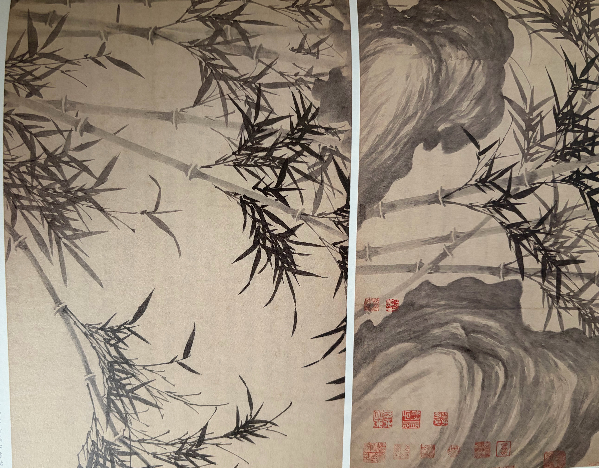

馆藏／公共预览（Wikimedia Commons《李衎四清图卷.png》之 3840px 宽缩略图，转 JPEG；全卷极横，高度仅 326px。公共下载不等于商业许可）：

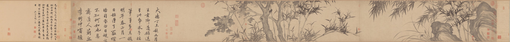

---

## p.88（`pages/04-6c87f6cd8cea.jpg`）

> 此乐令人欲加餐，况复咨嗟苜蓿盘。仲宾为玄卿作墨竹，玄卿诗以纪之。余爱其萧洒，乃为书此诗于其后。至大元年（1308）仲春既望，吴兴赵孟頫书。

赵跋之署，去李衍画成不过月余，乃墨渖新干时题。跋中所录，则为画主王玄卿所作七言古诗，其诗在述尽卷上风物之余，亦足证纳尔逊—阿特金斯艺术博物馆与北京故宫博物院所藏原属同卷。但即便没有此诗，只需将此图与画家所述《竹谱详录》稍加比对，卷上所绘竹之品类亦判然可辨。

《竹谱详录》成书历经数年。据李衍自序，初稿约成于大德三年（1299），大德十一年（1307）基本定稿，³同年王玄卿以纸求画，翌年遂成《墨竹》与《四清图》。此书乃李衍承黄庭坚（1045–1105）欲作竹史之遗志，以其登会稽，涉云梦，泛三湘，观九嶷，南趾交广，北经渭淇的广阔游历兼博考六籍子史、山经地志、百家众技、稗官小说与竺干龙汉之文，参酌刘宋（420–479）时人戴凯（亦名戴凯之）所撰史上首部《竹谱》增益补苴而成，意在使植伐者识竹之时节，工师审其物宜，画者究其精微。全书初为二十卷，今存有二，一为鲍廷博（1728–1814）刊于《知不足斋丛书》之七卷本，一为四库馆臣自《永乐大典》辑出，收入《四库全书》子部艺术类之十卷本。

七卷本首卷即专论画法，分为〈画竹谱〉〈墨竹谱〉两篇。前者分粘帧、矾绢、位置、描墨、承染、设色、笼套七步详解勾勒设色竹的画法，后者则循画竿、画节、画枝、画叶四个顺序具陈墨竹画法，兼配画样37幅，示正、反之例。第二卷又作〈竹态谱〉〈墨竹态谱〉两篇，依竹之根生笋长至壮老枯瘁兼风雨急乍之序，列图37幅，剖析竹与墨竹的各类名目与形态特征，补前卷未及。第三卷至第七卷为〈竹品谱〉，分全德品、异形品、异色品、神异品、似是而非竹品、有名而非竹品，附图79幅，叙各类竹共379种。⁴相较于戴凯之有谱无画与五代李颇、宋人文同之有画无谱，李衍所著可谓图文并茂。以其谱观其画，可知画家挥毫时定是胸有成竹。

李衍为王玄卿所绘此图作手卷之制，从右至左徐徐展卷，甫一入眼，便是一丛清密慈竹，竹叶纷披掩映，墨色浓淡分明（图2）。引目向左，可见节茎方正的方竹数竿，竹竿挺拔，节点分明。石畔新笋对出，一高一矮，外壳斑花以细笔勾勒，顶端嫩芽攒聚，一派勃然萌发的初春气象。石后亦画竹两竿，形态殊别于前方所绘慈竹与方竹，对照《竹谱详录》，当是书中“笙竹”条下所记石笙。前半卷截至于此，下文将试以《竹谱详录》中所述墨竹画法分析后半卷《四清图》。

李衍认为，画家自来位置最难。无论是勾勒设色竹抑或是墨竹，作画前须通观画幅形制，统筹竹竿多寡、根梢向背、枝叶疏密荣枯及地势起伏。构思既定，必先作草图，

**本页脚注**

> ³ 赵天叶撰，〈李衍《竹谱详录》各版本考析〉，载《美术》，2020年第3期，第118页。
>
> ⁴ 范景中著，《中华竹韵》，中国美术学院出版社，2011年，第166–177页。
>
> ⁵ （元）李衍述，《竹谱详录》，卷一〈画竹谱〉，《知不足斋丛书》本，叶五。

（脚注5的上标在 p.89。）

---

## p.89（`pages/05-eff18e857371.jpg`）

反复推敲，俟意满而后下笔。李衍虽重法度，有言“学者必自法度中来始得之”，竹者“慕远贪高，逾级躐等，放弛情性，东抹西涂，便为脱去翰墨蹊径，得乎自然”之弊，⁵却不抑各人才情好尚，只拈出切不可犯之位置十忌，余则各从己意。⁶

以是观《四清图》之布置，画为长卷，接《墨竹》之末，起首坡石渐显，二石一大一小，石间仍作笙竹四竿。主竿以重墨绘出健枝利叶，辅竿斜倚向左，恰与石下逸兰呼应，次竿依石势而立，末竿退隐深处。移目左睇，先是六竹渐次右倾，横出新竹一竿，枝叶向左上舒展，既与前段垂叶相承，又引观者向画卷深处行去。循画展卷，余下五竹两两交错，其下杂生细筱。古木两株一前一后相生成势，一竹夹立其间，贯连前后竹丛。及末，一杆细竹与一丛嫩叶小竹傍依古木延伸出来的一片扶疏枝叶收束全篇。通卷虽由四部分组成，但各部分既衔接自如，又可独立成画，以致明清鉴者均未察其有阙，足见画者置阵布势之巧妙。

位置既定，则言画竿。若只画竹一两竿，墨色运用可较为随意，但若画五竿以上，则应以浓墨画前竹，后竹渐淡。恰巧《四清图》上所余两部分，前者二石之间立竹四竿，均以淡墨画就，全凭穿插巧妙显示前后次序；后者绘竹八竿，横出之新竹竹竿墨色稍重，中间六竹依据前后关系墨色依次减淡，末竿则以中墨画讫。再细看所画竹梢至竹根，悉合竹之形态，梢头节距略短，逐渐向下放长，接近根部又渐渐收短，虽是一节节画下，笔意仍前后贯连，每竿墨色匀停，行笔平直，两边如界，自然圆正。⁷

立竿之后，画节亦非易事：

> 上一节要覆盖下一节，下一节要承接上一节，中间虽是断离，却要有连属意思。上一笔两头放起，中间落下，如月少弯，则便见一竿圆混。下一笔看上笔意趣，承接不差，自然有连属意。不可齐大，不可齐小，齐大则如旋环，齐小则如墨板。不可太弯，不可太远，太弯则如骨节，太远则不相连属，无复生意矣。⁸

《四清图》中所绘竹节谨守此理，上节笔势饱满下沉，下节笔锋承上启下，节间略带皴擦，连属自然。诸节大小参差，错落有致。竹枝则名目咸备，前半部分老枝多叶垂覆，后半部分嫩枝翘秀，外柔中劲，行笔迅疾利落：

> 生叶处谓之丁香头，相合处谓之雀爪，直枝谓之钗股，从外画入谓之垛叠，从里画出谓之迸跳。下笔须要遒健圆净，生意连绵，行笔疾速，不可迟缓。老枝则挺然而起，节大而枯瘦；嫩枝则和柔而婉顺，节小而肥滑。叶多则枝覆，叶少则枝昂。风枝雨枝，

**本页脚注**

> ⁶ 同注5，叶六B至叶七A。
>
> ⁷ （元）李衍述，《竹谱详录》，卷一〈墨竹谱〉，《知不足斋丛书》本，叶十七。
>
> ⁸ 同注7，叶十八A。

（此后缺 p.90–91 正文。p.92 以「触类而长」续此引文。）

---

## 图2（页码不可见；`pages/06-25dbf352115d.jpg`）

**原刊图注：** 图2（元）李衍《墨竹》卷，1308年，纸本墨笔，37.5cm×237.49cm，美国纳尔逊—阿特金斯艺术博物馆藏

照片裁切（两截如刊；原照顶部叶片已切，不补绘。无稳定的馆方预览下载，对象页见 `SOURCES.md`）：

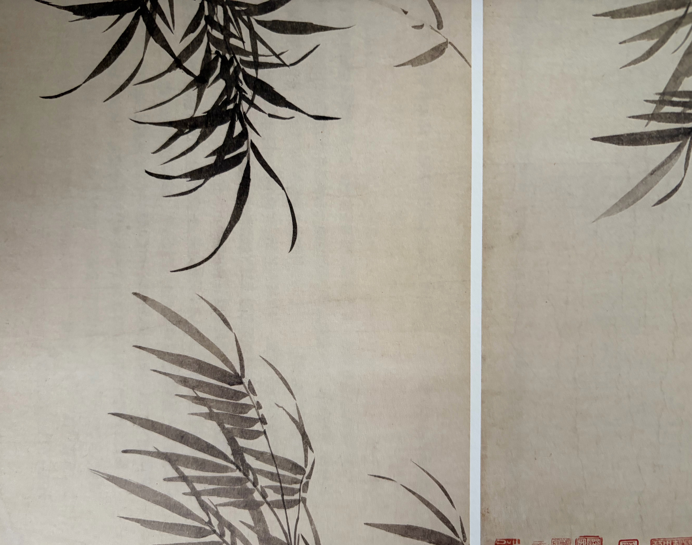

---

## p.92（`pages/07-d96f2e7e4c33.jpg`）

**原刊图注：** 图3-1（元）李衍《竹谱详录》（卷一〈画竹谱〉，位置十病举例）《知不足斋丛书》本，叶八

照片裁切（原照顶部签条已切）：

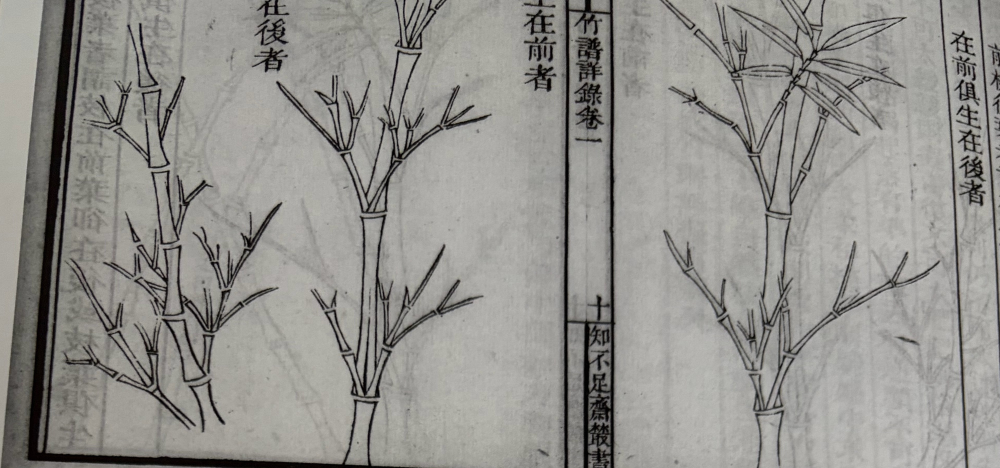

> 触类而长，亦在临时转变，不可拘于一律也。尹白邠王，随枝画断节，既非文法，今不敢取。⁹

画叶为写竹收官之笔，若不得法，则功亏一篑。由《四清图》观之，李衍画叶，下笔劲利，实按虚提，叶片翻正向背，转侧低昂，各有态度，铦利却不失婉柔。¹⁰“竹外三清”同样可见笔墨淋漓之妙。二石先以枯润并运之披麻皴写其形质，复以皱笔轻染阴阳，结构要处略施浓墨以资提挈，石身峻折坚凝，气韵浑厚，隐见董源遗法。古木以大点破墨成叶，状若梧桐，枝干则用墨自上而下顺势擦就，遒劲苍朴，柯叶蓊郁。全卷笔墨蕴藉丰润，格调冲和澹远，山野清幽，深然画外。

在条理清晰、细致具体的文字论述之外，李衍更以丰富的图谱（图3）解其所述墨竹之法：先以8图逐一说明画竹位置之十病；复就画竿、画节之法各配2图，与文辞互参；画枝则附图10幅，以示其名目姿态；末以8图析画叶七忌，左图右文，直观明了。

细究上述墨竹五法，除首末位置、画叶以外，余之三法依次言及“圆正”、“圆意”、“圆混”、“圆净”，画节、画枝又两度语涉“生意”，由是可知，李衍画竹，其竿、其节、其枝最重“圆”一字，“生意”则是其为画竹所立之标准，这两条要求同样体现在他勾勒设色竹的画法与画作（图4）之中：

---

## p.93（`pages/08-688724d0dc26.jpg`）

**原刊图注：** 图3-2（元）李衍《竹谱详录》（卷一〈画竹谱〉，“雨打风翻之墨竹”），叶二十七

照片裁切：

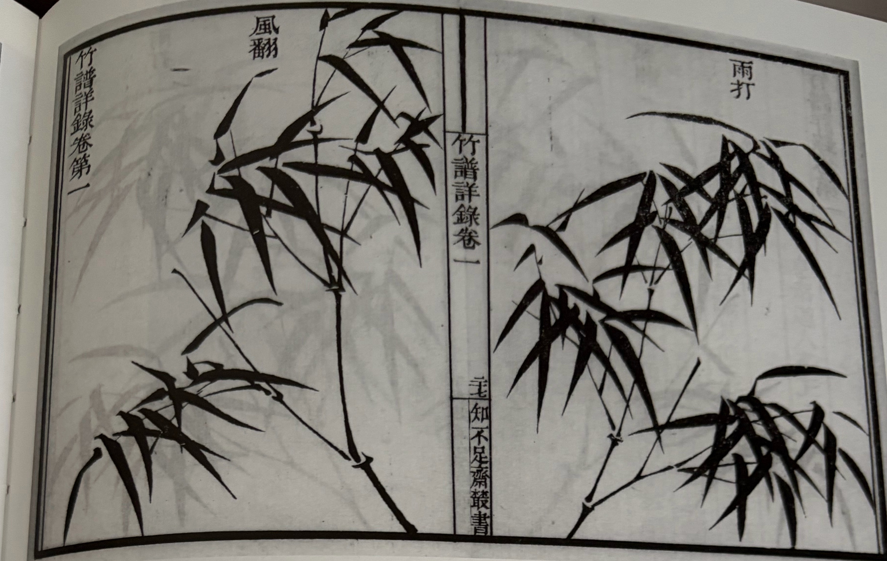

> 二描墨。握笔时澄心净虑，意在笔先，神思专一，不杂不乱，然后落笔。须要圆劲快利，仍不可太速，速则失势；亦不可太缓，缓则痴浊；复不可太肥，肥则俗恶，又不可太瘦，瘦则枯弱。起落有准的，来去有逆顺，不可不察也。如描叶则劲利中求柔和，描竿则婉媚中求刚正，描节则分断处要连属，描枝则柔和中要骨力。详审四时荣枯老嫩，随意下笔，自然枝叶活动，生意俱足。若待设色而后成竹，则无复有画矣。¹¹

李衍标举“生意”，乃自文同、黄庭坚而来：

> 墨竹位置，一如画竹法，但于节枝叶四者，若不由规矩，徒费工夫，终不能成画矣。凡濡墨有深浅，下笔有重轻，逆顺往来，须知去就，浓淡粗细，便见荣枯，乃要叶叶著枝，枝枝著节。山谷云：“生枝不应节，乱叶无所归。”须一笔笔有生意，一面面得自然，四向团欒，枝叶活动，方为成竹。……独文湖州挺天纵之才，比生知之圣，笔如神助，妙合天成，驰骋于法度之中，逍遥于尘垢之外，纵心所欲，不逾准绳。¹²

**本页脚注**

> ⁹ 同注7，叶十九A。
>
> ¹⁰ 同注7，叶二十四A。
>
> ¹¹ 同注5，叶十一A。
>
> ¹² 同注7，叶十六B至叶十七A。

---

## 图4（当为 p.94，页码不可见；`pages/09-c8f57090936d.jpg`）

**原刊图注：** 图4（元）李衍《纡竹图》轴，绢本设色，134.9cm×77.5cm，广州艺术博物院藏

照片裁切（已由横拍原照旋转至立轴方向；原照顶部或已略切。无馆方开放预览）：

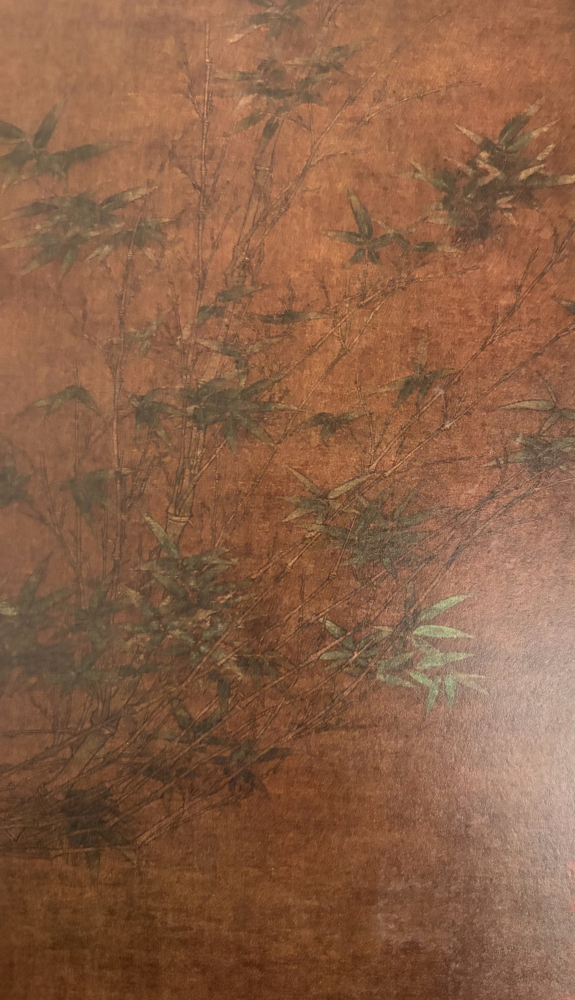

---

## p.95（`pages/10-2bf2682dec2a.jpg`）

《竹谱详录》甫一开卷，李衍即追述其瓣香文同之渊源，其间亦颇费一番周折。李衍早年观人画竹，特重用笔，却屡觉形神不类。及见金末王曼庆之作，气象迥异，方生学画之志。探本溯源，始知王曼庆得法于其父王庭筠（1151–1202），而王庭筠又承自文同一脉，然因未见真迹，尚疑其盛名。至元乙酉年（1285）至钱塘，经友人王子庆引荐，得见文同画竹真迹一本，述评所见：

> 一幅五挺，浓淡相依，枝叶间错，折旋向背，各具姿态，曲尽生意，如坐渭川、淇水间。

至此，李衍方知前贤所誉不虚，遂高价求购。未果，唯用油纸临摹，携归扬州。次年四月，重访故地，终以二十五券重金购得原作，了慰平生所愿。随后又连获文同画作三本，摒弃旧习，专尚真迹，日积月累，于画竹一法渐有所悟。¹³

广州艺术博物院藏有一件传为文同之《墨竹图》（图5），虽不若台北故宫博物院藏本知名，但较其完整，且天头地尾可见翁方纲（1733–1818）、吴荣光（1773–1843）、康有为（1858–1927）等清代名家之赏鉴题跋，本身亦属流传有绪之名迹。画中自左向右以墨笔绘竹一竿，奇态横出，或是笙竹。竹竿墨色匀净，行笔流畅；竹节脱续而生，气脉贯连；竹枝细劲，丁香头、雀爪、钗股、垛叠、迸跳诸法齐备；竹叶浓淡交织，劲中含柔，潇洒飘逸，疑风可动。赏读此图，恍如亲历二百年前李衍辗转十余本后终见文同真迹的那一初窥堂奥、灵明洞彻之刹那。

《竹谱详录》成书后，〈画竹谱〉之开篇曾被吴镇撮录入画，¹⁴台北故宫博物院所藏其《墨竹谱》册中更可见《仿息斋画竹》一开（图6），吴镇于题跋中直言乃仿李衍而作，署款“至正十年（1350）夏六月十日”，时年已届古稀。此开只画墨竹一竿，自左上横出，复折向下，枝叶随竿披垂。竹节虽未渲染，却因笔势轻重转折自然分出，尽显画者对竹理画法之内化。竹枝多迸跳而出，间作雀爪；竹叶一抹即成，笔情豪纵，恣肆而不失生趣。整体观之，吴镇笔墨较李衍更趋简括，虽称仿作，实则取其理法而自出机杼，终成与李衍工致写实之风同源而异流的、风格清疏放逸的墨竹面貌。

### 三

前述《竹谱详录》第三卷至第七卷分六品载竹近四百种，在种类繁多的竹子中，李衍何以偏偏选择慈竹、方竹、笙竹三者入画？这就触及《竹谱详录》以儒家比德论为纲领所织就的竹品谱系，其深层旨趣乃指向古代文人常言之“君子比德于竹”。李衍图中所画慈竹、笙竹均属“南北俱有，宜入画者”之全德品，叙列品下各竹之前，特作小序，发凡起例：

**本页脚注**

> ¹³ （元）李衍述，《竹谱详录》，卷一，《知不足斋丛书》本，叶一A至叶二B。
>
> ¹⁴ （元）吴镇跋，〈竹卷跋〉，李修生主编，《全元文》卷一〇四七，江苏古籍出版社，1998年，第91–92页。

---

## p.96（`pages/11-273db7491416.jpg`）

> 竹之为物，非草非木，不乱不杂，虽出处不同，盖皆一致。散生者，有长幼之序；丛生者，有父子之亲。密而不繁，疏而不陋，冲虚简静，妙粹灵通，其可比于全德君子矣。画为图轴，如瞻古贤哲仪像，自令人起敬起慕。是以古之作者，于此亦尽心焉。故作全德品。¹⁵

全德品之首即《四清图》中所画笙竹。李衍于条中详细讲述到笙竹主要产自江浙一带，广泛分布于河南北、湘汉两江之间，又据出笋期、形态和材性将其分作六种，明确记述石笙出笋时，笋带斑花，竹节促密，竹性柔韧，偏宜栽植于有石之地。¹⁶对照所述与插图（图7），即可确认海外所藏前卷《墨竹》之二笋及其周围皆是石笙。第七条“苦竹”之后，又见李衍归结道，全德品下前七种竹品格尤高，而其所师之文同多画笙竹。

慈竹为第二十五条，载曰：

> 慈竹又名义竹，又名孝竹，两浙江广处处有之，高者至二丈许，丛生，一丛多至数十百竿，根窠盘结，不引他处，四时出笋，经岁始成竹，子孙齐荣，前抱后引，故得此名。汉章帝三年（78），子母竹生白虎殿前，谓之“孝竹”，群臣作〈孝竹颂〉。唐明皇后苑有竹，丛密，笋不外出，顾诸王曰：“父子兄弟相亲当如此竹。”因号“义竹”。又名紫云盖。任昉《述异记》云：“南中生子母竹，慈竹是也。”……王勃〈慈竹赋〉曰：“如母子之钩带。”乔琳〈慈竹赋〉曰：“类宗族之亲比。”〈晋安海物记〉云：“义竹亦曰兄弟竹，秋丛生曰秋竹。”注云：“其笋丛生，俗谓之兄弟竹，笋味不中食也。”《新安志》云：“慈竹丛生，不离母。四时有笋，袅袅如钓竿，一名四季竹。”今秋竹、四季竹别见。¹⁷

附图以示慈竹状貌（图8）后，李衍尚记古人虽少画慈竹，但其故友李仲方喜作，且评李氏曾为高克恭（1248–1310）所画慈竹一幅绝佳。

方竹则为形状诡怪，如虞舜重瞳、高辛广颡等特异于常之异形品下第一条。与前卷体例一致，李衍在条中同样具陈其两浙江广之生长分布、节茎方正等形态特征、柱杖最佳之实用价值及相关记载与传说，并于“六棱竹”条后补记虽古人少画方竹，但完颜亮（1122–1161）与李仲方喜作，盖爱其方正。¹⁸

要言之，《竹谱详录》一书不仅以系统的名物分类与形性记录呈现出鲜明的博物学观察特征，更通过比德思想赋予竹以深厚的人伦寓意。李衍借竹之散生、丛生、前抱后引、笋不外出，比附长幼有序、父子兄弟相亲、子孙齐荣、母慈子孝，体现出其对孝悌亲伦

**本页脚注**

> ¹⁵ （元）李衍述，《竹谱详录》，卷三竹品谱一，《知不足斋丛书》本，叶一B。
>
> ¹⁶ 同注15，叶一B至叶三A。
>
> ¹⁷ 同注15，叶十三B至叶十四B。
>
> ¹⁸ （元）李衍述，《竹谱详录》，卷四竹品谱二，《知不足斋丛书》本，叶一B至叶二A。

---

## 图7、图8（对开刻本，页码不可见；`pages/14-0c0362ab69d3.jpg`）

正文在 p.96 已引图7、图8。此开无正文，夹位大约在第96页前后；因 p.96 与下一正文页文气顺接，不视为打断正文。

**原刊图注：**

- 图7（元）李衍《竹谱详录》（卷三〈竹品谱〉，“笙竹”）叶二B至叶三A
- 图8（元）李衍《竹谱详录》（卷三〈竹品谱〉，“慈竹”）叶十四B至叶十五A

对照方便，先给出带原刊图注的对开（图7上半在拍摄时已被切去）：

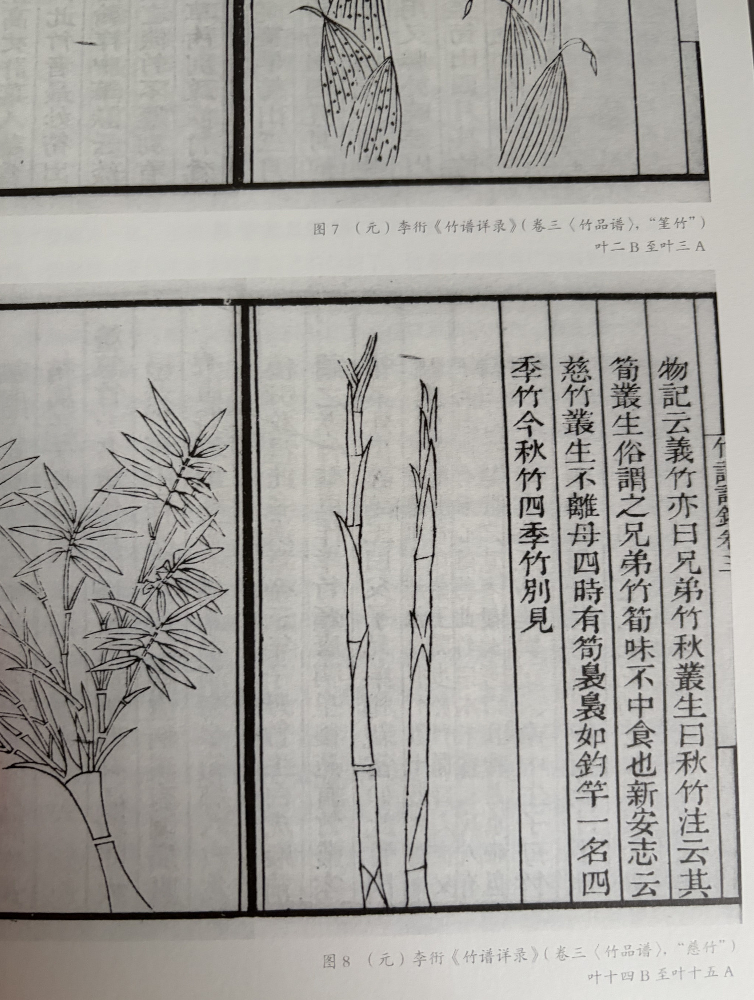

图7单裁（仅存下部，不补绘上半）：

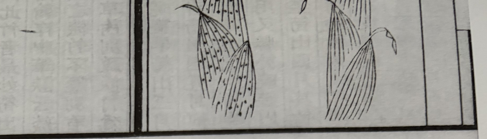

图8单裁（右侧版口在原照中已略切）：

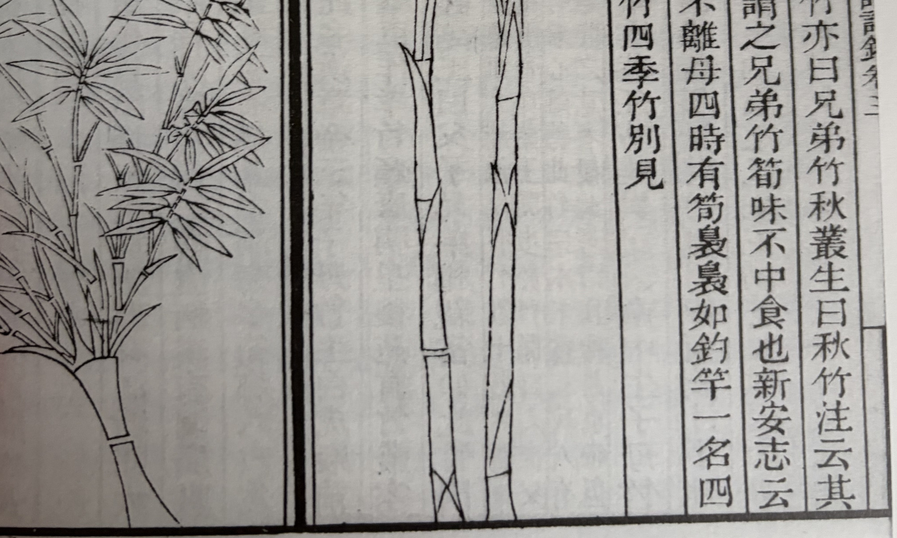

---

## 续文＋图5（页码不可见；`pages/12-7db671700ae5.jpg`）

**原刊图注：** 图5（宋）文同（传）《墨竹图》轴，纸本墨笔，124.7cm×144.6cm，广州艺术博物院藏

照片裁切（图版印于续文页天头；原照左侧题跋与画边或已略切。无馆方开放预览）：

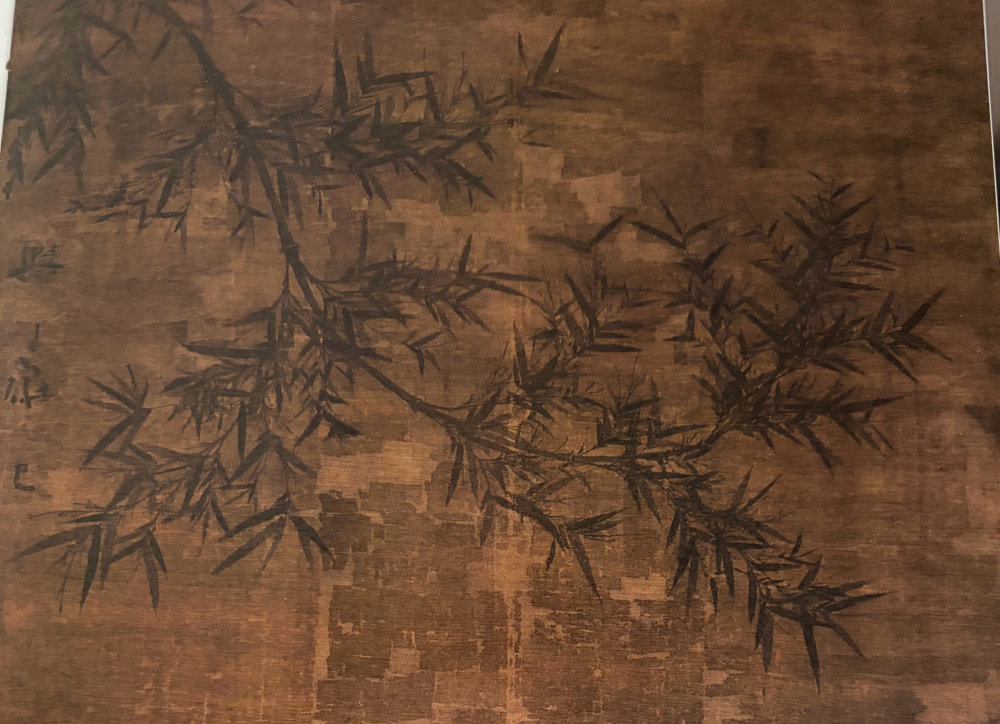

与士人德性的重视，但这一比德思想并未止步于文字层面的名物训释，而是在绘画实践中转化作视觉艺术。《竹谱详录》成书次年绘就的《四清图》中，竹竿疏密有序、枝叶相承相让，既是自然生机的写照，亦是君子间相辅相亲之隐喻。相较于书中“义竹”、“孝竹”、“兄弟竹”等名目的直接伦理指涉，《四清图》将竹之各态置入由兰石、梧桐构成的清雅境域，使竹之劲节、石之坚毅、兰之幽贞、梧之朴雅相互映发，有力地暗示出人伦秩序与清、正、和、贞之士人德范共生的理想图景。是故，《竹谱详录》构筑比德思想的名物学基础与伦理框架，而《四清图》则完成了这一思想从文字到图像的转化、从分类到境界的升华，使比德不再依赖说明，而内化为画面整体的精神气象，令人观之如瞻高贤仪像，自生敬慕。

唐人张彦远《历代名画记》开卷即言：“夫画者，成教化，助人伦，穷神变，测幽微，与六籍同功，与四时并运，发于天然，非由述作”，此论虽是套语，但亦道出古人论画之根本旨归。早期绘画多依附礼制与史教，以忠臣孝子、贤君列女彰显伦理秩序，使人

（本页未见脚注。页码不可见。）

---

## 收束＋图6（页码不可见；`pages/13-ab7668674893.jpg`）

**原刊图注：** 图6（元）吴镇《墨竹谱》册（二十开之十五，《仿息斋画竹》）纸本墨笔，40.3cm×52cm，台北故宫博物院藏

照片裁切（已旋转至与馆方预览一致；右上仍可见少许杂志页边）：

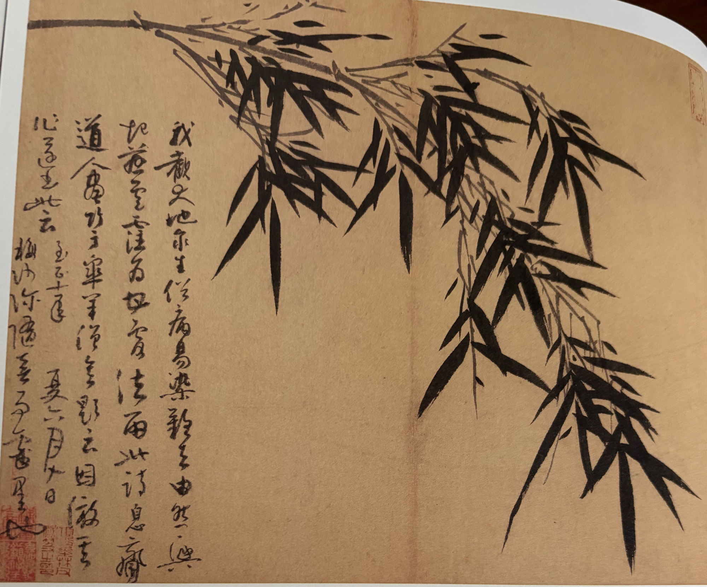

馆藏／公共预览（台北故宫低阶图，CC0，含装裱与开数 15。公共下载不等于商业许可）：

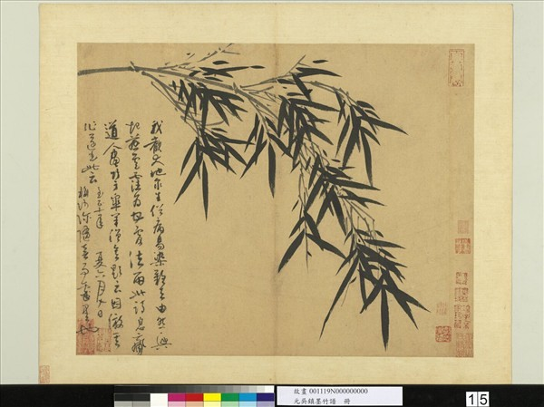

观其像而知其德。及至唐宋，诸门画科渐兴，但图画教化之功仍未废弛。山水、花竹、翎毛虽不直写人事，却可寄托品格、象征德性。竹之虚怀有节、石之卓立不屈，兰之芬馥远溢、梧桐之清贵守正皆成士人自况与劝勉之象。观画者在玩味笔墨意趣之余，亦被引入对人格修养与伦常秩序的体认之中。至此，图画“成教化，助人伦”不再局限于叙事内容，而更体现为审美化的道德引导。图画以其独特的视觉呈现与审美方式，将抽象的道德原则转化为可感的精神体验，在润物无声中实现其社会功能与文化使命。

（本页未见脚注、期刊名、责任编辑或作者简介。文止于此，未见续篇痕迹。页码不可见。）

---

## 校对备注

1. **刊名未落实。** 多次检索作者、标题与文末独特文句，未找到正式刊名、年期或完整起止页。不能指认为某一种杂志。脚注3引自《美术》2020年第3期，只能说明本文不早于2020年。
2. **缺页。** p.86–87、p.94 有对应图版照片，正文可顺接，不视为缺正文，但仍标明夹位。p.90–91 **缺正文**（p.89「风枝雨枝，」至 p.92「触类而长」），不据通行《竹谱详录》回填。图7–8对开无正文，不打断 p.96 与续文的衔接。续文页与收束页页码不可见；收束页止于「文化使命。」，其后是否还有版权页或作者简介，照片中未见。
3. **「李衍」不作「李衎」。** 封面、正文、图注、脚注中的姓名，印刷字形均为「衍」（氵＋行），不是「衎」（忄＋行）。馆方与通行著录作李衎，只入备忘。
4. **「笙竹」「石笙」不作「筌竹」。** 赵孟頫跋「笙有笋兮兰有芳」，以及 p.88、p.89、p.95、p.96 与图7图注，用字均为竹头下「生」。通行《竹谱详录》及画史多作「筌竹」（竹头下「全」）。本稿按原刊字形转录，不改为「筌」。这很可能是排印问题，但不能在正文里暗改。
5. **「了办」「度藏」「樵李」「着录」。** 李衍自题作「始得了办」，不改为「了辨」。李日华作「度藏」，不改为「虔藏」。藏印作「樵李氏鹤梦轩珍藏记」，通行或作「檇李」，不改。安岐一段作「并着录于其《墨缘汇观录》」，保留「着录」。
6. **「艺术博物所藏」。** p.85「美国纳尔逊—阿特金斯艺术博物所藏前半卷」在「博物」与「所藏」之间未见「馆」字。同页稍早及 p.88 作「艺术博物馆」。按原刊缺字转录，不补「馆」。
7. **「南趾交广」「竺干龙汉」「萧洒」「伪满州国」「柱杖」。** 均按原刊。通行或作「南至」「竺乾」「潇洒」「伪满洲国」「拄杖」，不暗改。
8. **「皱笔」与「皴擦」。** p.92「披麻皴写其形质，复以皱笔轻染阴阳」，同一句中「皴」「皱」并用，按原刊。p.89「节间略带皴擦」作「皴」。
9. **「四向团欒」。** p.93 引文用「欒」，保留繁体字形。
10. **「二描墨」。** p.92 末作「之中：」，p.93 以「二描墨」起。中间若仅有图4整页，则未见「一……」。不补「一描墨」或顿号。画竹七步中「描墨」是第四步，原刊此序号的含义不能从现有书页完全坐实。
11. **「尹白邠王」「既非文法」。** p.92 引文按原刊；不改为较常见的人名或「画法」。
12. **图1尺寸。** 图注作 35.6cm×359.8cm，与故宫名画记宽度一致。名画记作「设色」，图注作「墨笔」；不改图注。
13. **图4不是《双钩竹图》。** 图注为广州艺术博物院藏《纡竹图》，134.9cm×77.5cm。南方网等写作 138.5×79 cm，只入备忘。字形已据立轴方向的高清图注确认为「纡」（纟＋于），不是「纤」。
14. **脚注14。** 「《全元文》卷一〇四七」按原刊。1998年江苏古籍出版社本通行编次为60册，该数字或为篇次，或为排印问题，不改为册次。
15. **生年差异。** 本文李衍作 1244–1320，馆方及不少著录作 1245–1320。吴镇本文作 1280–1354。均按原刊。
16. **无「□」，无【】补字。** 已见书页中的正文、图注与脚注均可读出；缺页处只标明中断，不用通行文本填空。

（全文脚注 1–18 已按出现页次抄在各页之下，出处核对见 `SOURCES.md`。）
