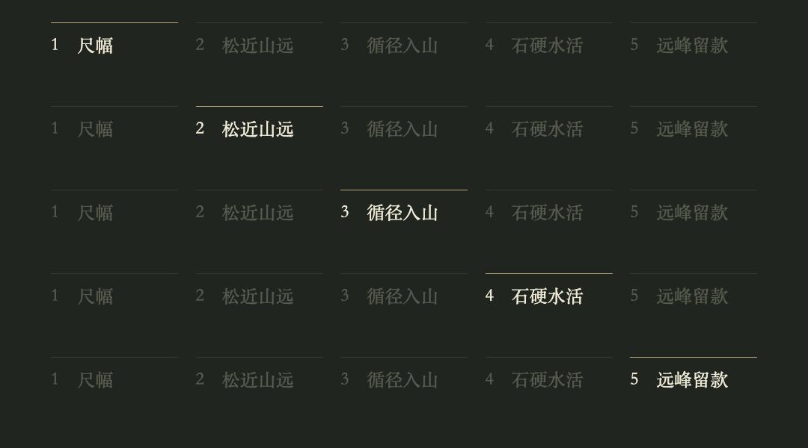

# 顶部章节导航

《万壑松风图》竖版中，用户认可顶部细线、编号、短章名和当前章高亮的样式。可用于后续多段赏析，让观众知道现在看到哪里、接下来还有什么。它是章节导航：分段等宽，不表示实际时长占比，也不必增加逐秒进度条。短片或只有一个观看问题时可以省略。



上图由随附组件渲染，逐行展示各章高亮状态，是模板预览，不是五条同时出现在成片中。

## 先组织章节，再排版

从已确定的脚本归纳几个观看步骤，而非每镜一个标签。例如本集是“尺幅 → 松近山远 → 循径入山 → 石硬水活 → 远峰留款”。通常3–5章适合单行竖屏；名称尽量短，每章可以包含多个镜头。新画作重新命名、分组，不能把松林、山径和题款强加给其他作品。

名称在全片保持固定，当前章以较亮文字和顶端细线高亮，其余低对比。该样式不做闪烁、滚动或跟随镜头的缩放。作品、作者、年代可以在导航上方单独放一行；章节栏本身不代替作品信息、字幕或生成段落标识。

## 可复用组件与配置

- [React / Remotion 组件](../assets/chapter-navigation/ChapterNavigation.tsx)：复制到自己的工程，只依赖React，不需要额外插件、网络或字体下载。
- [本集章节配置](../examples/wanhe-chapters.json)：实际123秒、24fps成片的章节时码与配色；无私人素材和路径。

在已有Remotion工程的根组件中使用，放在镜头的`Sequence`、淡入淡出和相机变换层之外：

```tsx
import {useCurrentFrame, useVideoConfig} from 'remotion';
import {ChapterNavigation} from './ChapterNavigation';
import config from './wanhe-chapters.json';

// Root component body; frame is the composition-global frame.
const frame = useCurrentFrame();
const {fps, width, height} = useVideoConfig();
// Include this JSX alongside, rather than inside, your shot sequences:
<ChapterNavigation chapters={config.chapters} frame={frame} fps={fps}
  canvasWidth={width} canvasHeight={height} {...config.style} />
```

不依赖CSS transition或墙钟动画，随机取帧与完整渲染得到同样状态。`start/end`单位为秒，按`Math.round(seconds * fps)`与画面剪辑对齐；开始帧包含、结束帧不包含。同一帧结束旧章、开始新章，时码取叙事段落切换点，而非任意一条跨镜叠化的尾帧。配音、插段或删镜改变时长后同步更新配置。

配置应从0开始，按时间排列，ID唯一，正时长、连续无空缺无重叠，最终`end`等于全片长度；每章至少占一个实际输出帧。组件只根据时码选择高亮，不是计划验证器；`validate_plan.py`不检查此独立配置。剪映等其他编辑器可将各章文字/细线作为持久图层，在章边界切换样式，使用同一份时码表；若先烘焙到画面底片，要记录为不可独立编辑的图形，不能称为原生文字轨。

## 版式与验收

1080×1920示例：顶部139px、左右68px、字24px、段间23.5px；暖白当前文字、灰绿未选文字、淡金当前细线。它们只是本片起点，不是平台安全区或所有画作的默认配色。组件默认按画布比例缩放；配置里的显式像素值不会自动缩放，换尺寸需重设或省略。横版重新选择位置、字号和间距，不能照搬竖版坐标。

栏内长标签不会自动截断；若单行放不下，优先缩短章名、减少章节或重排留白，避免只缩小到手机不可读。选择本机可用、覆盖所用汉字的字体，渲染前确认字形，不假定随附字体。顶部与目标应用界面冲突时整体下移，并同步下移标题/画面；不要遮住原画讲解点。

在最终文件抽查每章开始、中间、结束以及切换前后一帧：当前章正确、上一章恢复弱色，原画转场时栏的位置不跳动、不消失；检查最长章名、字幕、生成标识和片尾互不遮挡。另在手机尺寸核对可读性和对比度。配置检查与测试截图不能替代最终文件检查。
