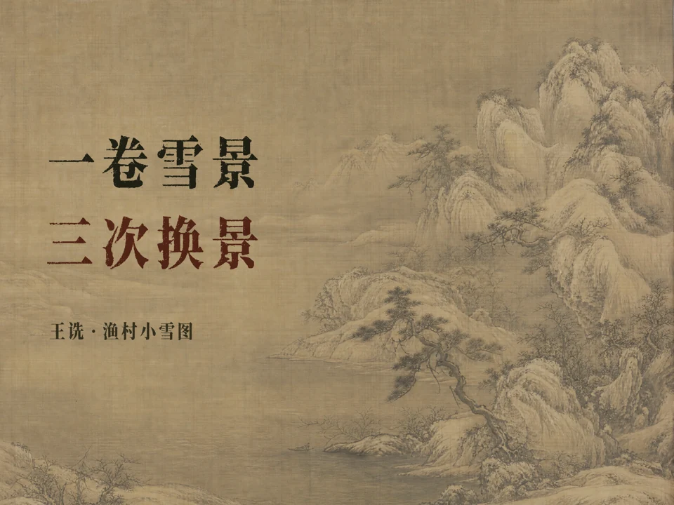

# 王诜《渔村小雪图》：已完成制作案例

2026-11-04，用户确认成片满意，并要求将流程特别是字体部分沉淀到技能。本例由60秒预案发展为120.667秒成片；[实测编排](../examples/wangshen-yucunxiaoxue-produced-plan.json)是时间线摘录，不是可直接渲染的工程。未把单集视频、原画母版、音色参考、私人Board标识或字体二进制打包进仓库，也未代用户发布社交笔记。

## 作品与叙事

主件为故宫博物院藏北宋王诜《渔村小雪图》卷，新00093902，绢本设色，画心44.5×219.5cm。以[故宫藏品页](https://www.dpm.org.cn/collection/paint/234606.html)为尺寸主据，不混用台北同名卷。

以“一卷雪景，为什么像换了三次镜头？”组织观看：渔村让目光靠近，主峰带它深入，烟水让它放远。沿原画岸线、遮挡和前后山体展示视角变化，没有把研究中的空间阅读讲成物理拼接、画错了或北宋通行规则。

雪景不只解释为留白：据故宫说明，峰顶、树杈和沙脚还施白粉；材料信息明确归于馆方，不把屏幕上的浅色当成自行完成的颜料鉴定。[上博展品说明](https://www.shanghaimuseum.net/mu/frontend/pg/m/article/id/P00002775)记本幅无款印、前隔水题名中王字残缺；本片说清是“作者款印”，没有误称画上完全没有后人题印。题名归属与年羹尧获罪后藏画进入清宫的经过据[故宫展览条目](https://www.dpm.org.cn/vr/stone-moat/wyd_11.html)，不以未释读的某一印章单独证明全部流传史。

原画图像采用[Commons同件扫描](https://commons.wikimedia.org/wiki/File:%E7%8E%8B%E8%AF%9C%E6%B8%94%E6%9D%91%E5%B0%8F%E9%9B%AA%E5%9B%BE%E5%8D%B7.png)，53150×3451、301713665字节，来源栏指向名画记，文物号一致。文件页PD-scan标签与馆方书面授权不是同一回事，案例不声称持有后者。完整扫描校验后，题名、隔水和拖尾裁切与此前用于渲染的局部逐一比对一致；原字残损保留，现代释文另排。

## 长卷、尺度与动态

开场0–7秒采用6500×2066的连续宽幅原画，在1920×795视窗中等比从右向左浏览一段。预案的1200×2066竖裁不具备这样的横移余量；中段裁切也重取，覆盖主峰而非只留山体一侧。开头不声称看完了整卷。

7–13.5秒交代尺寸，用A4纸与画心同一厘米比例示意，随后才进入细读；手卷不默认配成人身高。三段视角的并置比较与前后切换都用原图，文字不压过原画。

两条Seedance 2.0无声源片均实测1280×720、24fps、6.041667秒，名义选段为源0.5–4.5秒：

| 成片秒数 | 作用 | 实际处理 |
| --- | --- | --- |
| 25.958–29.958 | 渔村溪水与小舟轻动 | 源片已有生成的“AI笔墨延展”字样，保留并加常驻来源行，避免重复叠第二个角标 |
| 56.708–60.708 | 寒松细枝与微澜 | 后期整段标AI；水域过亮的新增水纹按原参考图限制增亮幅度，树枝区域保留原运动，原始源片另存 |

限制增亮所用的水域矩形与12/255阈值只适用于此源片，不作为其他画作的默认调色。原画分析仍回到静态原图，不把动态、修饰或封面重构当作笔法、材料和原文证据。镜头用8帧完整布局叠化，本片参数不代替新片实际检查。

## 实际字体与排字

| 角色 | 实际选择 | 本例落地 |
| --- | --- | --- |
| 视频篇名与封面主标题 | 南西油墨宋 | 真实字体文件加载；封面两行218px，墨色与暗朱红；署题74px。数值仅适用于2304×1728本例 |
| 连续解说字幕 | Songti SC Regular | 外部最终合成46px，无整块底板、轻阴影；墨色`#34362E`，淡金`#A16B14`重点词保持同一宋体 |
| 现代题名排录、景名与短释文 | 霞鹜文楷 | 与原迹图像分开，按字号、留白与位置区分层级，不每镜换字族 |

南西油墨宋由用户提供的下载包取得，内部family为`NanxiYoumosong`、PostScript名为`NanxiYoumosong-Regualr`，版本为1.000；本例文件SHA256为`61ea2320a5742cf39cb0ff95e3ed684d422b2f4bcb0bce8c4d80584bbf578dcd`。后续复用检查实际文件与字符覆盖，不把内部拼写自动改成另一个名称。包内说明称个人和企业可免费商用；本库不含字体文件，不把该说明扩大成已获字体文件再分发许可。

封面实际调用YouMind的GPT Image 2 medium，以本卷为内容参考生成完全无字的4:3底图，再用用户选定字体排“一卷雪景／三次换景”，署“王诜·渔村小雪图”。让文字落在同一连续古绢空间，用轻量乘色与底纹融合，没有独立标题色块。保留无字底图、透明标题PNG和排字源；PNG是可独立合成的位图，改字仍需字体和源配置。

这与此前“让模型生成宋体风格文字”不同：本例可以确认用了真实南西油墨宋文件。标题精确性不交给图像模型猜测，但底图仍真实经过参考生图，不能将其写成纯原图裁切。

上图为封面创意重构，不是原画档案；仓库只附缩略图，不含字体或原作母版。后续字体分工见[字体与文字层级](typography.md)，构图原则见[封面设计](cover-design.md#渔村小雪图准确字体与无字底图)。

## 声音与时间线

沿用用户已认可的原创磁性中低男声，经YouMind调用Seed Audio 1.0，8段选用旁白，共418汉字。送入声音模型时用王申辅助王诜的shēn发音，显示姓名始终王诜；该替字只留在语音输入与对应记录中。

流传段初次转写把“辗转”写成“达转”，不能单靠ASR判定发音错误；交付前改成“历经波折”，并把容易连读的“没收入清宫”改成“收进清宫”，只重做受影响一段。修订保持41字及该段时长，字幕一起更新。实际采用秒级分句锚点、波形剪静音与段内插值，不声称逐词强制对齐。

处理后每段约3.85汉字/秒，包含段内停顿；算上两段动态呼吸及片头尾，全片约3.46字/秒。这是本片节奏，不推广为所有艺术视频的固定速度。

配乐新任务未出音频，最后复用此前已认可的生成疏琴片段：44.124秒，3次循环、1.5秒交叉淡化；溪水和远风新生成。三条独立48kHz立体声轨，开头即铺环境与琴声，讲解时配乐让位。声音来源不因跨集复用而改写成真实录音。

## 剪映与验收

最终成片由Open Montage / Remotion加FFmpeg输出，120.666667秒、1920×1080、24fps、2896帧、22镜；H264 yuv420p、BT709。最终响度−17.88 LUFS，真峰值−1.91dBTP。

共59条独立字幕，18条含少量淡金重点词；剪映v1提供无解说字幕的画面底片与旁白、BGM、音效三轨，已打开、抽查4秒/27秒/84.25秒并原生保存。篇名、导航、图示和AI标记在底片内，不能称全部文字原生可编辑。本例没有剪映原生导出，不把编译工程或代理渲染写成原生导出。

字体测试需保留真实结果：v1系统宋体在剪映预览比外部宋体Regular略重；v2改用从系统字体集中提取的独立Regular文件后，预览出现无衬线回退，未采用。没有证据证明两种渲染像素一致，也未确定所有回退的根因。不要把“已经填了字体路径”当验收结论，或把这一文件接入失败推广成独立TTF普遍不可用。最终选用v1，独立测试版本另标未采用，通用检查见[剪辑与交付](editing-delivery.md)。

完整解码通过，22镜抽帧及生成片段已查看；2896帧缩小灰度扫描未发现近乎全空帧或孤立整帧亮度尖峰，但不能据此证明没有局部微闪。声音检查包括转写、波形与编码文件响度，不把它们写成主观全片试听。
